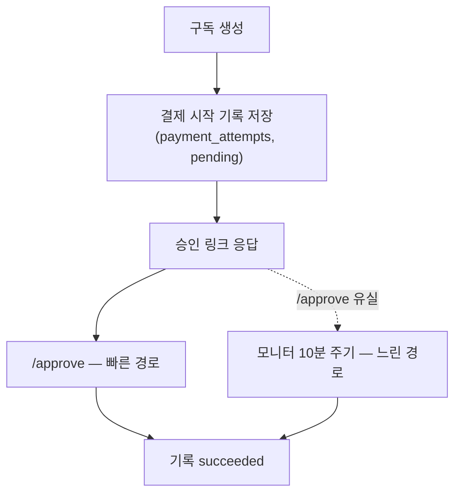
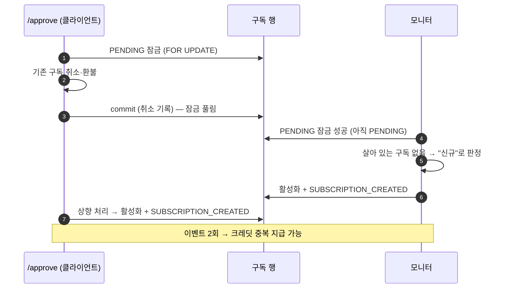
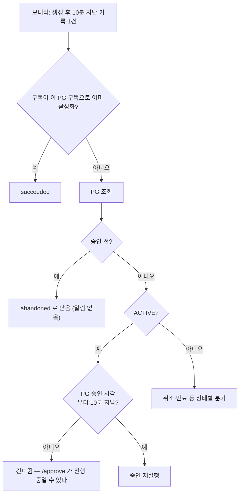
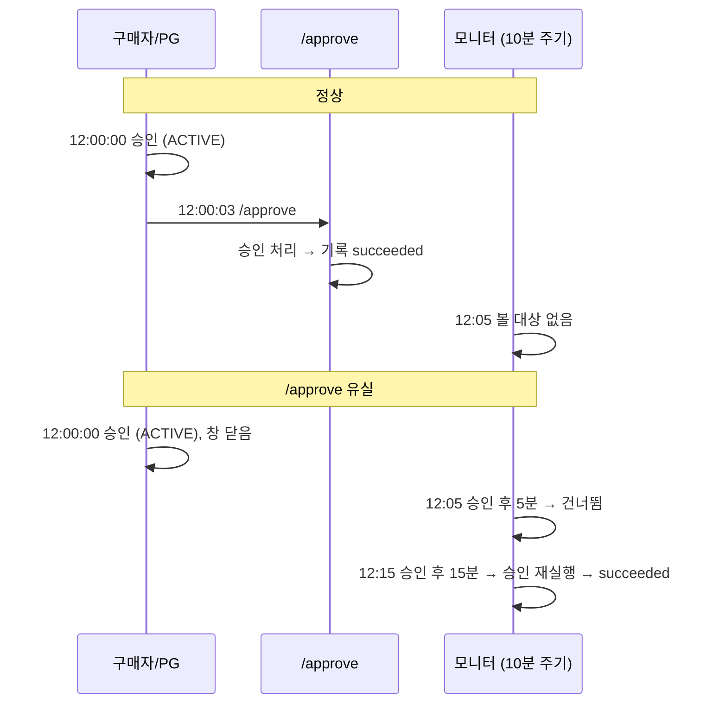

# 01. 결제 승인을 두 곳이 동시에 돌릴 때: 조건부 UPDATE 대신 "시간으로 비켜 가기"를 고른 이유

장애 상황 훈련: 구매자가 결제 승인 직후 창을 닫아 서버가 승인 결과를 못 받았다. 이를 줍기 위해 10분 주기 모니터를
붙였더니, 이제 **같은 결제를 클라이언트 요청과 모니터가 동시에 승인할 수 있게 됐다.** 행 잠금이 중간 commit 에서
풀리는 구조라 잠금만으로는 막을 수 없었다.

## 1. 상황

### 결제 흐름

PayPal 같은 정기결제 PG는 이렇게 동작한다.

1. 서버가 PG 에 구독을 만들고 승인 링크를 클라이언트에 준다.
2. 구매자가 PG 화면에서 승인하면 **PG 가 그 자리에서 첫 결제를 청구한다.**
3. 클라이언트가 서버에 `POST /approve` 를 보내면 서버가 구독을 활성화한다.
   - 상향(기존 구독 → 더 비싼 플랜)이면 기존 구독을 환불·취소하고 새 구독을 활성화한다.
   - 활성화하면 `SUBSCRIPTION_CREATED` 이벤트를 발행하고, 다른 서비스가 이 이벤트로 크레딧을 지급한다.

3번이 유실되면(창 닫힘·네트워크 끊김) 돈은 나갔는데 서비스는 아무것도 모른다.

### 고친 방향

Stripe 의 PaymentIntent 패턴을 따랐다. **결제 시작 시점에 의도를 저장하고, 결과는 여러 경로가 확정한다.**



### 새로 생긴 문제: 승인이 두 곳에서 돈다

승인 함수는 대기 중인 구독 행을 `SELECT ... FOR UPDATE` 로 잠그고 시작한다. 그런데 **상향 경로는 중간에 commit 한다**
(기존 카드 결제 취소 기록, 기존 구독 정리 — 다른 결제 수단과 공유하는 함수라 바꿀 수 없었다). **commit 하면 행 잠금이
풀린다.** 그 틈에 두 번째 승인이 들어오면, 기존 구독이 이미 취소된 것을 보고 "신규 구독"으로 판정해 한 번 더 활성화한다.



- 돈이 더 나가지는 않는다. 크레딧이 두 번 지급될 수 있고, 사람이 되돌릴 수 있다.
- 상향을 한 commit 으로 끝내는 경로(같은 PG 끼리)는 잠금이 끝까지 유지돼 이 문제가 없다.

## 2. Python에서는

스택: FastAPI + async SQLAlchemy + Postgres. 모니터는 Kubernetes CronJob(10분, `concurrencyPolicy: Forbid`)이다.

### 처음 안: 조건부 UPDATE 로 기록을 선점

상태값은 commit 해도 남으므로 행 잠금처럼 중간 commit 에 풀리지 않는다.

```sql
UPDATE payment_attempts SET state = 'processing', updated_at = :now
 WHERE id = :id AND state = 'pending'      -- 1행이면 내가 처리, 0행이면 누가 처리 중
```

원리는 맞다. 하지만 이건 **테이블 위에 잠금을 직접 만드는 것**이고, 직접 만든 잠금이 풀어야 하는 문제가 전부 따라온다.

| 문제 | 그대로 두면 | 막으려면 |
|---|---|---|
| ① 모든 종료 경로에서 해제 | 빠뜨린 return·except 에서 `processing` 고착 | 라우터·모니터의 모든 출구에 상태 복귀 |
| ② 처리 중 프로세스가 죽음 | 영구 고착 | 만료(lease) + "내가 잡은 시각일 때만 쓰기"(펜싱) 또는 heartbeat |
| ③ 결제창 여러 개 | 기록이 결제창마다 따로라 각각 선점 성공 → 못 막음 | 선점과 함께 구독 행 잠금도 |
| ④ 기존 함수가 `processing` 을 모름 | 웹훅 보류 누락·기록 중복 | 헬퍼 여러 곳 수정 |
| ⑤ API 응답 변화 | 선점 실패를 202 로 주면 이미 끝난 승인의 재요청도 202 | 실패 시 상태를 다시 읽어 분기 |

만료 시간도 정하기 어렵다. 승인 + 망취소 최악 경로가 PG 호출 여러 번(호출당 타임아웃 60초)이라 약 10분인데,
만료를 짧게 잡으면 살아 있는 처리와 겹친다.

결제 승인 경로 10곳 넘게 손이 가고, 각각이 새 버그 후보다. 그런데 이걸로 막는 경합은 아래처럼 드물다.
→ "현재 요구를 충족하는 가장 단순한 구현"이 아니라고 판단했다.

### 고른 안: 시간으로 비켜 가기

클라이언트 `/approve` 는 구매자가 승인한 **직후(보통 수 초)** 에 온다. 모니터가 **PG 승인 후 10분 지난 건만** 승인을 다시
돌리면 두 승인이 같은 순간에 돌 일이 사실상 없다.





**남는 위험**: 세 조건이 동시에 맞아야 한다. ① `/approve` 가 승인 후 10분 넘게 지나 도착, ② 그 순간 모니터가 같은 건을
처리 중, ③ 상향의 중간 commit 틈(수 초)에 겹침. 결과는 크레딧 중복이다. 모니터가 승인할 때 "승인 후 경과 시간"을 로그와
Slack 으로 남겨, 실제로 보이면 그때 선점을 넣기로 했다.

**함께 얻은 것**: "결제창만 열고 나간 것"으로 닫은 기록이 늦게 승인되면 웹훅이 기록을 다시 연다. 다시 연 행은 생성
시각이 오래돼 생성 시각 기준이면 대기를 건너뛴다. 기준을 **PG 승인 시각**으로 두었기 때문에 다시 연 행에도 10분 대기가
그대로 적용된다.

### 그래도 조건부 UPDATE 를 쓴 곳

웹훅이 닫힌 기록을 다시 여는 곳은 조건부 UPDATE 를 썼다. 여기는 "한 번만 연다"만 보장하면 되고, 이후 처리는 모니터가
하므로 해제·만료 문제가 없다. **선점(긴 처리를 독점)과 멱등 상태 전이(한 번만 바꾸기)는 다른 문제다.**

```sql
UPDATE payment_attempts SET state = 'pending', result_message = NULL
 WHERE id = :id AND state = 'failed' AND result_message = 'abandoned'   -- 재전송이 겹쳐도 한 번만
```

### 비교

| | 조건부 UPDATE 선점 | 시간으로 비켜 가기 |
|---|---|---|
| 막는 범위 | `/approve`↔모니터 경합 전부(보완을 다 넣으면) | 승인 직후 겹침. 10분 뒤 늦게 온 `/approve` 는 남음 |
| 바뀌는 곳 | 10곳 이상, 상태값 추가, 펜싱 | 모니터 분기 1곳 |
| 새 버그 위험 | 높음 (결제 승인 경로) | 낮음 |
| 전제 | 없음 | PG 의 `status_update_time` = ACTIVE 전환 시각 |

## 3. Java에서는 (공부할 것 — 아직 코드로 안 돌려 봄)

Spring Boot + JPA 로 옮긴다면 확인해 볼 질문들이다.

1. **비관적 잠금** `@Lock(LockModeType.PESSIMISTIC_WRITE)` 는 `SELECT ... FOR UPDATE` 다. 잠금은 트랜잭션이 끝날 때
   풀린다. Python 의 "중간 commit" 에 해당하는 것은 Spring 에서 무엇인가?
   - 공유 서비스의 `@Transactional(propagation = REQUIRES_NEW)` 는 별도 트랜잭션이라 바깥 잠금을 안 푼다. 바깥
     트랜잭션을 끝내고 새로 여는 구조라면 같은 틈이 생긴다.
   - 한 `@Transactional` 로 끝까지 잡으면 잠금은 유지되지만, 그 안에 PG 환불 호출(외부 HTTP)이 들어간다.
     → [Spring 02. 트랜잭션 안의 외부 호출과 커넥션 풀 고갈](../../study/spring/02-connection-pool.md) 과 정면으로 부딪힌다.
     **잠금을 오래 쥐는 것과 외부 호출을 트랜잭션 밖으로 빼는 것은 같이 못 한다.** 이 긴장이 이 문제의 본질이다.
2. **조건부 UPDATE** 는 `@Modifying @Query("update Attempt a set a.state = 'PROCESSING' where a.id = :id and a.state = 'PENDING'")`
   가 돌려주는 `int` 로 이긴 쪽을 가른다. 영속성 컨텍스트에 이미 올라온 엔티티와 어긋나는 문제(`clearAutomatically`)를 확인한다.
3. **낙관적 잠금** `@Version` 은 위 선점과 무엇이 다른가? 충돌을 "나중에 알게 되는" 방식이라, 중간에 PG 환불 같은
   되돌릴 수 없는 일을 이미 한 뒤에 `OptimisticLockException` 이 나면 어떻게 되나?
4. **스케줄러 중복 실행**: Pod 여러 개에서 `@Scheduled` 가 동시에 돈다. Kubernetes `concurrencyPolicy: Forbid` 대신
   ShedLock 같은 분산 락을 쓰면 무엇이 달라지나?
5. **시각 비교**: Python 쪽은 DB 에 KST naive datetime 을 저장하고 PG 의 UTC 시각을 KST 로 바꿔 비교했다. Java 는
   `Instant`/`OffsetDateTime` 으로 저장·비교하면 이 변환 실수가 없어지는가? `Clock` 을 주입해 "승인 후 10분"을 테스트하는 방법.
6. **처리 중 상태가 정말 필요해질 때**: 선점을 넣는다면 만료 + 펜싱 토큰(`where id = :id and claimed_at = :myClaimedAt`)을
   어떻게 구현하나. Spring Integration 의 `JdbcLockRegistry` 같은 기존 라이브러리로 대신할 수 있나.

## 4. 확인

- 테스트(pytest, SQLite): 생성 기록, `/approve` 성공·망취소·재조회 실패, 모니터의 상태별 분기(승인 직후 건너뜀, 10분 뒤
  승인, 미승인 abandoned, 취소 + 청구 흔적), 웹훅 재오픈 멱등, 결제창 여러 개 — 28건.
  - SQLite 는 `FOR UPDATE` 를 무시하므로 **동시성 자체는 테스트로 증명하지 못했다.** 시간 조건만 검증했다.
- 테스트가 실제로 잡는지 확인: 승인 후 10분 대기 제거, 재오픈 제거, 생성 후 10분 필터 제거 등 코드를 일부러 망가뜨리면
  해당 테스트가 실패했다(5가지 모두).
- PG sandbox 실측: 승인 클릭 08:40:22Z → `status_update_time` 08:40:31Z, 첫 청구 08:40:30Z. 즉 ACTIVE 전환 시각이 맞다.
  단 이 값은 "마지막 상태 변경 시각"이라 취소하면 다시 바뀐다(08:40:57Z). ACTIVE 일 때만 승인 시각으로 쓴다. 승인 전
  구독은 `null` 이다.
- 운영: 모니터가 `/approve` 없이 승인할 때마다 Slack 으로 "승인 후 경과 시간"을 남겨 관찰하고, 문제가 있으면 롤백한다.
