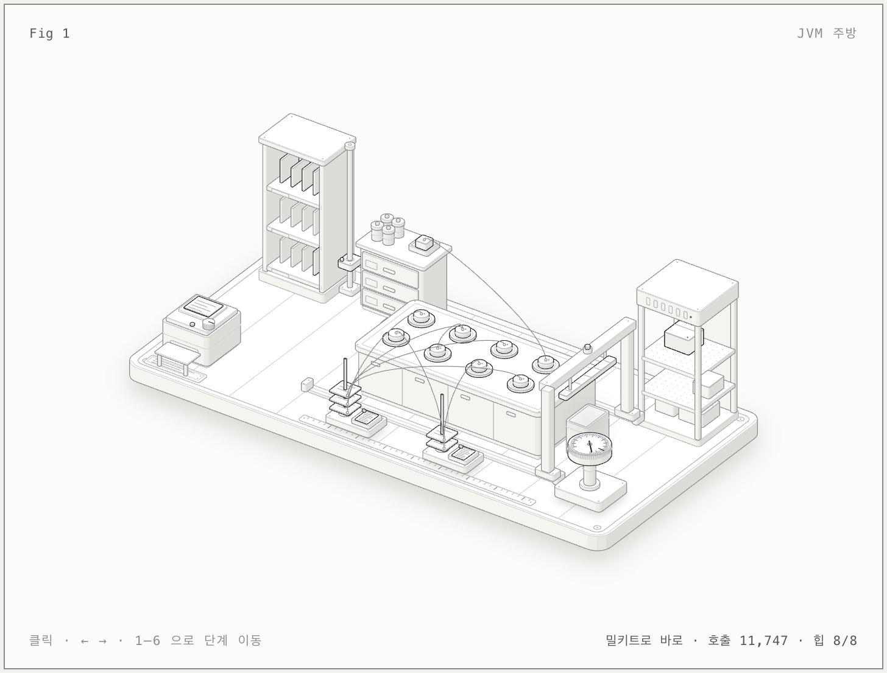

# 01. JVM은 어떻게 동작하나 (식당 주방 비유)

참고 영상: ByteByteGo, [How the JVM Actually Works](https://www.youtube.com/watch?v=bF28LFPjFsI)

Java 코드가 기계어로 실행되기까지를 식당 주방에 빗대어 정리했습니다.

[](https://kbj804.github.io/java-in-practice/study/jvm/figures/kitchen/kitchen-light.html)

그림을 누르면 움직이는 버전이 열립니다. 레시피 카드 출력(빌드) → 3단 선반에서 카드 찾기(클래스 로딩) → 서랍 열기(링킹·초기화) → 주문서 꽂이와 조리대(Stack·Heap) → 밀키트 냉장고(JIT) → 정리 갠트리(GC) 순서로 돌아가고, 클릭이나 ← → 키, 1~6 숫자 키로 단계를 옮길 수 있습니다. ([다크 테마](https://kbj804.github.io/java-in-practice/study/jvm/figures/kitchen/kitchen.html), 그림의 호출 수와 임계값은 설명용 숫자입니다.)

```
레시피 원고(.java) ─본사(javac)─▶ 표준 레시피 카드(.class)
  ─▶ ① 카드 꺼내 오기(클래스 로더)
  ─▶ ② 개점 전 준비(링킹·초기화)
  ─▶ ③ 주방 공간 배치(런타임 데이터 영역)
  ─▶ ④ 요리하기(인터프리터 + JIT)
  ─▶ ⑤ 정리 담당(GC)
```

## 0. 빌드: 전 세계 지점 공통 레시피 카드 만들기

- 내가 쓴 레시피 원고(`.java`)를 본사(`javac`)가 **표준 레시피 카드**(`.class`)로 바꿔 줍니다.
- 카드에는 두 가지가 있습니다.
  - **조리 순서**: 바이트코드
  - **카드 머리말**: 메타데이터(요리 이름, 재료, 누가 볼 수 있는지)
- 한국 지점이든 미국 지점이든 주방 장비(OS, CPU)는 달라도, 각 지점 주방장(JVM)이 같은 카드를 읽고 자기 장비로 요리합니다. 이것이 "Write once, run anywhere"입니다.
- 카드는 낱장(.class), 묶음(JAR), 모듈 중 어떤 형태로 와도 됩니다. 주방장이 찾는 것은 결국 조리 순서와 머리말입니다.

## ① 클래스 로더: 카드는 주문이 들어오면 그때 꺼냄

- 개점할 때 모든 레시피를 펼쳐 놓지 않습니다. 그 메뉴 주문이 처음 들어올 때 카드를 가져옵니다(lazy loading). 한 번도 안 팔린 메뉴의 카드는 끝까지 안 꺼낼 수도 있습니다.
- 찾는 순서가 정해져 있습니다(parent delegation).
  1. **본사 기본 매뉴얼**: Bootstrap 클래스 로더, `java.lang.Object` 같은 핵심 클래스
  2. **지역 본부 매뉴얼**: Platform 클래스 로더, JDK 플랫폼 클래스
  3. **우리 지점 레시피**: Application 클래스 로더, 클래스패스나 모듈패스의 내 코드
- 본사부터 보는 이유는 보안입니다. 누가 우리 지점 서랍에 가짜 "기본 밥 짓기" 카드(가짜 `java.lang.String`)를 넣어 놔도, 본사 진짜 카드가 먼저 쓰입니다.

## ② 링킹과 초기화: 개점 전 준비

| 단계 | 하는 일 | 주방 비유 |
|---|---|---|
| 검증(Verification) | 바이트코드가 스택을 망가뜨리거나 잘못된 형변환(정수를 객체 참조인 척)을 하지 않는지 확인 | 카드에 말도 안 되는 지시가 없는지 검수 |
| 준비(Preparation) | static 필드 메모리를 잡고 기본값(숫자 0, 참조 null)을 넣음 | 공용 재료통 자리를 만들고 일단 비워 둠 |
| 해석(Resolution) | 이름으로 된 참조(심볼릭 참조)를 실제 런타임 참조로 바꿈. 일부는 지금, 일부는 처음 쓸 때 | "B 소스 참고"를 "냉장고 3번 칸"으로 바꿈 |
| 초기화(Initialization) | static 필드에 코드에 적힌 값을 넣고 static 블록 실행 | 재료통에 진짜 재료를 채우고 개점 준비 |

## ③ 런타임 데이터 영역: 주방 공간 배치

| 구분 | 영역 | 담는 것 | 주방 비유 |
|---|---|---|---|
| 모든 스레드가 공유 | **Heap** | 모든 객체 | 큰 공용 조리대. 만들어진 음식이 전부 여기 놓임 |
| 모든 스레드가 공유 | **Method Area** | 클래스 메타데이터, 메서드 정보, static 변수, 런타임 상수 풀 | 레시피 보관함과 공용 양념통 |
| 스레드마다 따로 | **JVM Stack** | 메서드 호출마다 프레임 하나(지역 변수, 중간 결과) | 요리사 앞의 주문서 꽂이. 주문(메서드 호출)마다 한 장씩 꽂고, 끝나면 뽑음 |
| 스레드마다 따로 | **PC Register** | 지금 실행 중인 바이트코드 명령 위치 | 요리사가 지금 카드의 몇 번째 줄을 하고 있는지 |
| 스레드마다 따로 | **Native Method Stack** | JNI로 네이티브 코드를 부를 때 쓰는 스택 | 외부 업체 장비를 쓸 때 따로 적는 메모 |

요리사 한 명이 스레드 하나입니다. 조리대는 함께 쓰고, 주문서 꽂이는 각자 씁니다.

## ④ 실행 엔진: 처음엔 카드 보며, 많이 팔리면 손에 익혀서

HotSpot 같은 운영용 JVM은 두 방식을 섞어 씁니다.

- **인터프리터:** 카드를 한 줄씩 읽으면서 바로 요리합니다. 컴파일을 기다리지 않아 바로 시작하지만, 요리 자체는 느립니다.
- **핫스팟 감지:** JVM은 실행 중에 코드가 몇 번 쓰이는지 셉니다. 자주 실행되는 코드는 핫스팟으로 표시합니다.
- **JIT 컴파일러:** 핫스팟 바이트코드를 이 CPU에 맞춘 네이티브 기계어로 컴파일해 **코드 캐시**에 저장합니다. 다음에 그 메서드가 불리면 해석하지 않고 컴파일된 버전을 씁니다.
  - 주방 비유: 많이 나가는 메뉴는 우리 주방 장비에 맞춘 **밀키트**로 미리 만들어 **밀키트 냉장고**에 넣어 두고, 다음 주문부터 바로 냅니다.
- 그래서 Java 서버는 처음엔 조금 느리고, 돌수록 빨라집니다(워밍업).

## ⑤ GC: 정리 담당 직원

- GC Root에서 더 이상 닿지 않는 객체는 회수 대상이 됩니다. GC가 이런 객체를 찾아 메모리를 되돌려 받습니다. 개발자가 직접 메모리를 해제하지 않아도 됩니다.
  - 주방 비유: 조리대 위 음식 중에 **어떤 주문서와도 연결이 끊긴 것**을 정리 담당이 치웁니다.
- 대가도 있습니다. 수집기와 작업량에 따라 멈춤(pause)이나 지연이 생길 수 있어서, 지연에 민감한 프로그램은 동작을 예측하기 어려워집니다.
  - 주방 비유: 대청소할 때는 요리사들이 잠깐 손을 멈춰야 할 수 있습니다(Stop-the-World).
