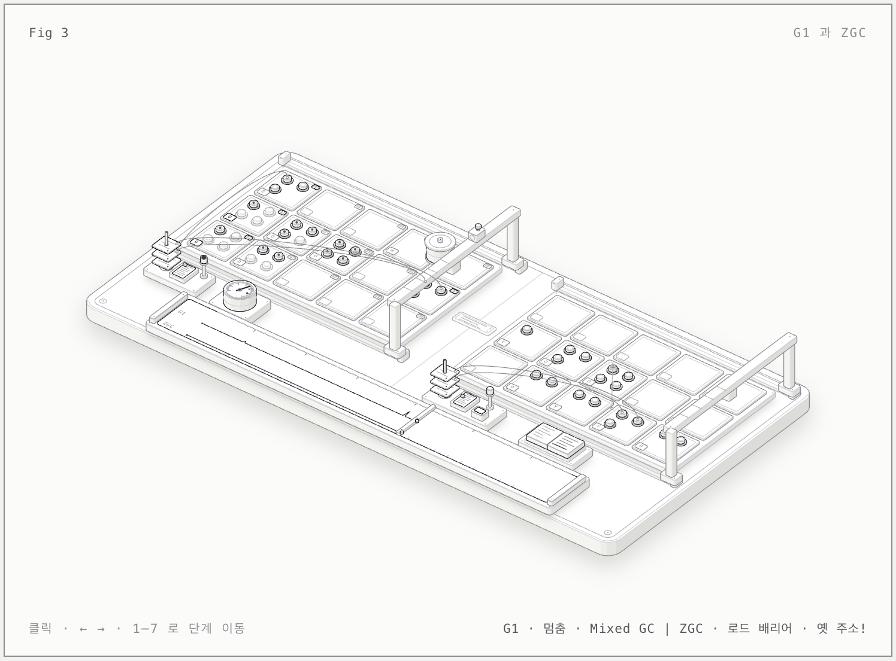

# 03. G1 vs ZGC: 왜 GC가 두 개고, 각각 어떻게 동작하나

[02. 세대별 GC](02-generational-gc.md)에 이어지는 노트입니다. 주방 비유를 이어 가고, 근거는 공식 문서와 직접 돌린 실험입니다.

- [Oracle JDK 21 GC 튜닝 가이드: G1](https://docs.oracle.com/en/java/javase/21/gctuning/garbage-first-g1-garbage-collector1.html)
- [JEP 439: Generational ZGC](https://openjdk.org/jeps/439) (JDK 21), [JEP 474](https://openjdk.org/jeps/474) (JDK 23부터 기본 모드), [JEP 490](https://openjdk.org/jeps/490) (JDK 24부터 이 모드만 남음)

[](https://kbj804.github.io/java-in-practice/study/jvm/figures/g1-vs-zgc/g1-zgc-light.html)

그림을 누르면 움직이는 버전이 열립니다([다크 테마](https://kbj804.github.io/java-in-practice/study/jvm/figures/g1-vs-zgc/g1-zgc.html)). 뒤쪽 주방이 G1, 앞쪽 주방이 ZGC이고, 아래 기록계 두 줄에 두 GC의 멈춤이 그려집니다. 부품 뜻은 그림 아래 범례에 있습니다. 멈춤 시간과 칸 배치는 설명용으로 단순화한 값입니다.

## 한 줄 요약

| | G1 | ZGC |
|---|---|---|
| 목표 | 처리량과 멈춤 시간의 균형. 멈춤 목표(기본 200ms)를 높은 확률로 지킴 | 멈춤 시간 최소화. 멈춤 1ms 이하, Heap 크기와 무관 |
| 객체 옮기기(압축) | **멈춘 상태에서** 옮김 | **애플리케이션이 도는 중에** 옮김 |
| 핵심 장치 | Region, 쓰레기 많은 Region부터 고르기, Remembered Set | Colored Pointer, Load Barrier, Forwarding Table |
| 대가 | Heap이 크고 살아 있는 객체가 많으면 멈춤이 길어짐 | 모든 참조 읽기에 검사 비용, 메모리와 CPU에 여유가 있어야 함 |
| 기본값 | JDK 9부터 JVM 기본 GC | `-XX:+UseZGC`로 켬 |

## 왜 두 개가 있나

GC는 세 가지를 한꺼번에 최고로 만들 수 없습니다.
- **처리량:** 같은 CPU로 애플리케이션 일을 얼마나 많이 하나
- **멈춤 시간:** 한 번에 얼마나 오래 멈추나
- **메모리:** Heap을 얼마나 여유 있게 써야 하나

객체를 옮기는 일(압축)은 피할 수 없습니다. 그대로 두면 Heap에 구멍이 숭숭 생기기 때문입니다. 문제는 **옮기는 동안 요리사(애플리케이션 스레드)가 옛 자리의 접시를 집으면 안 된다**는 점입니다. 이걸 해결하는 방법이 두 가지입니다.

- **G1:** 옮기는 동안 **잠깐 영업을 멈춥니다.** 대신 한 번에 다 옮기지 않고, 멈춤 목표 안에 끝낼 만큼만 골라 조금씩 옮깁니다.
- **ZGC:** **영업을 멈추지 않고** 옮깁니다. 대신 요리사가 접시를 집을 때마다 "이 접시 이사 갔나?"를 확인하는 장치를 붙입니다.

그래서 대부분의 서비스는 기본값인 G1으로 충분하고, Heap이 수십 GB 이상이거나 응답 지연이 튀면 안 되는 서비스는 ZGC를 고릅니다.

## G1: 쓰레기 많은 칸부터 치우는 청소 팀

**주방 비유:** 주방 바닥을 같은 크기의 **타일 칸**으로 나눕니다. 칸마다 "배식대(Eden)", "임시 선반(Survivor)", "보관(Old)" 스티커를 붙입니다. 청소 팀은 영업을 잠깐 멈추고, **쓰레기가 가장 많은 칸부터** 골라 그 칸의 살아 있는 접시만 빈 칸으로 옮긴 뒤 그 칸을 통째로 비웁니다.

### 구조

- **Region:** Heap을 같은 크기의 Region으로 나눕니다(이 맥에서는 4MB). Region마다 Eden, Survivor, Old, 빈 칸 역할이 붙고, Young Region은 Heap 여기저기에 흩어져 있어도 됩니다.
- **Humongous 객체:** Region 절반 이상 크기인 객체는 처음부터 Old Region 여러 개를 연달아 차지합니다. 주방 비유로는 여러 칸에 걸친 큰 냄비입니다.
- **Remembered Set:** Region마다 "바깥 어디에서 이 Region을 가리키는지"를 적은 명부입니다. Heap은 512바이트 카드 단위로 나눠 기록합니다. 이 명부 덕분에 일부 Region만 청소할 때 Heap 전체를 뒤지지 않아도 됩니다. 주방 비유로는 칸마다 붙은 방문자 명부입니다.

### 한 사이클

1. **Young-only 단계:** 평소에는 Young Region만 청소합니다(Young GC). 멈춘 상태에서 Eden과 Survivor의 살아 있는 객체를 다른 Region으로 옮기고, 나이가 찬 객체는 Old로 보냅니다.
2. **Concurrent Start:** Old 사용량이 기준치(IHOP, 기본은 자동 조정)에 닿으면, 그때의 Young GC가 **마킹 시작** 역할도 함께 합니다.
3. **Concurrent Marking:** 영업 중에 조사원이 Old에서 살아 있는 객체를 표시합니다. 방식은 **SATB(Snapshot-At-The-Beginning)**입니다. 조사를 시작한 순간 사진을 찍어 두고, 그때 살아 있던 객체는 이번 사이클 동안 살아 있는 것으로 칩니다. 도중에 죽은 객체를 다음 사이클로 미루는 대신 Remark 멈춤이 짧아집니다.
4. **Remark (짧은 멈춤):** 마킹을 마무리하고, 완전히 빈 Region을 바로 회수합니다.
5. **Cleanup (짧은 멈춤):** Old를 치울 가치가 있는지 판단합니다.
6. **Mixed GC:** 이제 Young Region 전부에 **쓰레기가 많은(살아 있는 데이터가 적은) Old Region**을 몇 개 섞어 함께 옮깁니다. 이름 Garbage-First가 여기서 나왔습니다. 몇 개를 섞을지는 **멈춤 목표(`MaxGCPauseMillis`, 기본 200ms)** 안에 끝날지 예측해서 정합니다. 남은 예상 시간의 80%까지만 채웁니다.
7. Old에서 더 치울 게 별로 없으면 다시 1번으로 돌아갑니다.

### 실패하면

옮길 빈 Region이 없으면(Evacuation Failure) 이미 옮긴 것은 그대로 두고 나머지는 제자리에 남깁니다. 그래도 안 되면 **Full GC**로 Heap 전체를 제자리에서 압축하는데, 문서 표현대로 "매우 느릴 수 있습니다".

## ZGC: 영업 중에 접시를 옮기는 이사 팀

**주방 비유:** 이사 팀이 요리사들이 일하는 와중에 접시를 새 칸으로 옮깁니다. 요리사가 옛 자리를 찾아가면 안 되니, 접시로 이어진 **끈마다 색 꼬리표**를 붙여 둡니다. 요리사가 끈을 당겨 접시를 집을 때마다 **손목 검사기**가 꼬리표 색을 봅니다. "이사 전 색"이면 **이사 장부**에서 새 자리를 찾아 끈을 다시 매고, 꼬리표를 "확인됨" 색으로 바꿉니다. 그다음부터 그 끈은 검사 없이 바로 통과합니다.

### 핵심 장치 세 가지 (JEP 439)

- **Colored Pointer:** Heap 안의 참조(필드에 저장된 포인터)에 주소와 함께 **상태 비트**를 담습니다. "살아 있다고 확인됐나", "주소가 최신인가" 같은 정보입니다. 64비트 포인터를 쓰기 때문에 이 비트를 넣을 자리가 있습니다.
- **Load Barrier:** 애플리케이션이 객체 필드에서 참조를 **읽을 때마다** 끼워 넣는 짧은 코드입니다.
  - 빠른 길(fast path): 색만 보고 "할 일 없음"이면 바로 통과합니다. JIT가 애플리케이션 코드 안에 직접 넣습니다.
  - 느린 길(slow path): 객체가 이사 갔으면 **Forwarding Table**에서 새 주소를 찾아 필드를 고쳐 씁니다. 이것을 **self-healing**이라고 합니다. 한 번 고친 필드는 다음부터 빠른 길로 갑니다.
- **Store Barrier (세대별 ZGC부터):** 필드에 참조를 **쓸 때** 끼워 넣는 코드입니다. 두 가지를 합니다.
  - Old에서 Young을 가리키는 필드를 Remembered Set에 기록합니다. 정확한 필드 주소를 비트맵에 기록하고, 이 비트맵을 두 벌(double-buffered) 두어 GC와 애플리케이션이 서로 기다리지 않게 합니다.
  - SATB 마킹용으로 덮어쓰기 전 값을 GC에 알려 줍니다.

### 한 사이클

| 단계 | 멈춤? | 하는 일 |
|---|---|---|
| Pause Mark Start | 짧은 멈춤 | 마킹 시작 표시 |
| Concurrent Mark | 동시 | 살아 있는 객체 표시 |
| Pause Mark End | 짧은 멈춤 | 마킹 마무리 |
| Concurrent Prepare | 동시 | 옮길 Region(relocation set) 고르기 |
| Pause Relocate Start | 짧은 멈춤 | 옮기기 시작 표시 |
| Concurrent Relocate | 동시 | 살아 있는 객체를 새 Region으로 옮기고 Forwarding Table에 기록. 다 비운 Region은 **바로** 새 할당이나 이동 대상으로 재사용 |

멈춤 세 번은 모두 "이제 다음 단계"를 알리는 신호 정도라서, Heap이 커져도 길어지지 않습니다. 주방 비유로는 종을 세 번 짧게 치는 것뿐입니다.

### 세대별 ZGC

처음 ZGC(JDK 15)는 세대 구분 없이 매번 Heap 전체를 수집했습니다. JDK 21에서 세대별 ZGC가 들어왔습니다(`-XX:+ZGenerational`). JDK 23부터는 이 모드가 기본이고, JDK 24부터는 이 모드만 남았습니다. Young과 Old를 따로 수집하고, 살아 있는 객체가 많은 Young Region은 옮기지 않고 그 자리에서 나이를 먹입니다. JEP 439가 밝힌 목표는 할당 지연 위험, 필요한 Heap, CPU 사용을 모두 낮추는 것입니다.

### 실패하면: Allocation Stall

ZGC는 "애플리케이션이 메모리를 쓰는 속도보다 GC가 더 빨리 회수한다"는 전제로 동작합니다. 할당 속도가 회수 속도를 앞지르면, 새 객체를 만들려던 스레드가 **회수될 때까지 기다립니다**(Allocation Stall). 멈춤 로그에는 안 나오지만 응답은 그만큼 늦어집니다. 주방 비유로는 빈 접시가 없어서 요리사가 손을 놓고 기다리는 상황입니다. 대응은 Heap을 늘리거나 GC 스레드에 CPU를 더 주는 것입니다.

## 직접 확인: 같은 프로그램, G1 vs ZGC

[`gc-pause-demo/PauseDemo.java`](gc-pause-demo/PauseDemo.java)는 1KB 객체 100만 개(약 1GB)를 캐시처럼 들고 있으면서, 무작위로 새 객체로 바꿔 끼우고 요청마다 임시 객체를 만듭니다. 오래 산 객체가 계속 죽는, GC에 부담이 큰 작업입니다. JDK 21.0.13, 10코어 맥북에서 20초씩 돌렸습니다.

```sh
java -XX:+UseG1GC                    -Xms3g -Xmx3g -Xlog:gc,safepoint:file=G1.log  PauseDemo 20
java -XX:+UseZGC -XX:+ZGenerational  -Xms3g -Xmx3g -Xlog:gc,safepoint:file=ZGC.log PauseDemo 20
```

"멈춘 동안 GC가 일한 시간"은 safepoint 로그의 `At safepoint` 값입니다.

**Heap 3GB (빡빡하게)**

| | 멈춘 동안 일한 시간 중앙값 / 최대 | 멈춘 시간 합계 | 문제 상황 | 20초간 처리량(상대) |
|---|---|---|---|---|
| G1 | 13.9ms / 110.9ms | 10.8초 | **Full GC 30번** (합 2.1초) | 1.00 |
| ZGC | 0.005ms / 0.012ms | 0.004초 | **Allocation Stall 137번** (합 1.1초, 최대 39.8ms) | 1.34 |

**Heap 8GB (여유 있게)**

| | 멈춘 동안 일한 시간 중앙값 / 최대 | 멈춘 시간 합계 | 문제 상황 | 처리량(상대) | CPU user / sys |
|---|---|---|---|---|---|
| G1 | 128ms / 607ms | 14.0초 | Full GC 1번 | 1.00 | 30.1초 / 48.9초 |
| ZGC | 0.006ms / 0.013ms | 0.001초 | 없음 | 2.79 | 31.3초 / 1.9초 |

### 읽는 법

- **ZGC의 멈춤은 정말 짧습니다.** 수백 번 멈췄지만 GC 일은 한 번에 0.013ms를 넘지 않았고, Heap을 3GB에서 8GB로 늘려도 그대로였습니다. G1은 Heap이 커지자 멈춤도 커졌습니다(최대 111ms → 607ms). 문서가 말하는 "Heap 크기와 무관"이 그대로 보입니다.
- **두 GC는 실패 방식이 다릅니다.** Heap이 빡빡하면 G1은 Full GC로 길게 멈추고, ZGC는 Allocation Stall로 할당하는 스레드를 기다리게 합니다. ZGC의 멈춤 로그만 보면 멀쩡해 보이므로 Stall 로그(`Allocation Stall`)를 따로 봐야 합니다.
- **ZGC 3GB의 safepoint 도착 시간:** GC 일은 0.01ms였지만, 스레드가 멈출 지점(safepoint)에 도착하기까지 최대 37ms가 걸렸습니다. GC가 아니라 애플리케이션 쪽 지연이라 따로 봐야 합니다.
- **처리량은 일반화하면 안 됩니다.** 이 실험에서는 ZGC가 처리량도 높았지만, G1의 시스템 CPU 시간(49초)이 비정상적으로 커서 macOS의 메모리 처리 영향이 의심됩니다. 또 이 작업은 오래 산 객체가 계속 죽는 형태라 세대 가설이 잘 맞지 않습니다. 일반적으로 ZGC는 배리어 비용과 동시 GC 스레드 때문에 CPU와 메모리에 여유가 있어야 하고, JEP 439도 "메모리와 CPU가 충분해야 한다"는 전제를 명시합니다. 운영 서버(Linux)에서 실제 트래픽으로 비교하는 게 맞습니다.

## 고르는 기준

1. 처음에는 **기본값 G1**으로 시작합니다. 멈춤 목표가 필요하면 `-XX:MaxGCPauseMillis`만 조정해 봅니다.
2. GC 로그에서 **멈춤이 응답 시간 목표(SLO)를 깨거나**, Heap이 수십 GB라 G1 멈춤이 길어지면 **ZGC**를 검토합니다.
3. ZGC로 바꾼 뒤에는 멈춤 대신 **Allocation Stall**과 CPU 사용량을 봅니다. Stall이 보이면 Heap이나 CPU를 늘립니다.
