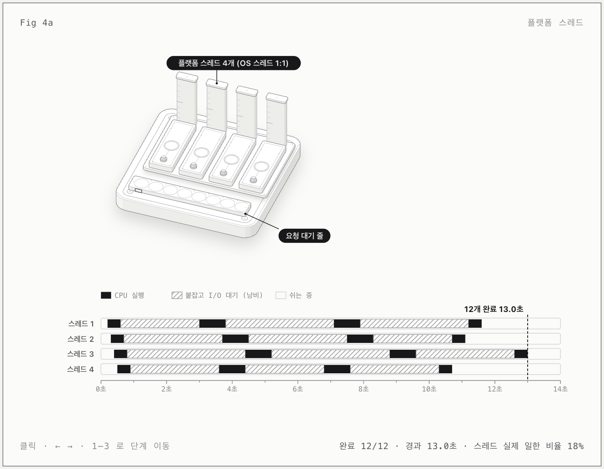
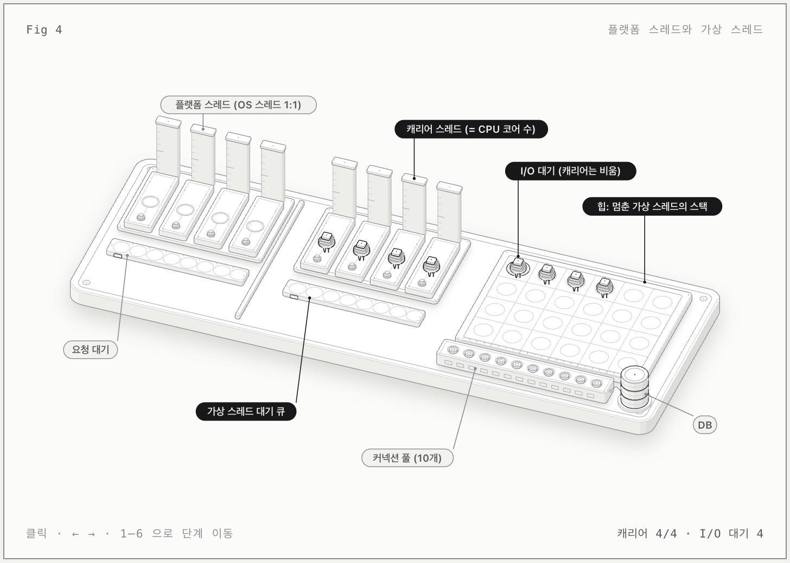
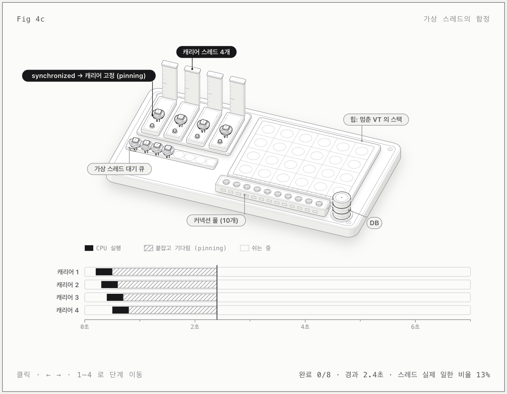

# 04. 가상 스레드 vs 플랫폼 스레드 (JDK 21)

요청 하나에 스레드 하나를 쓰는 방식은 그대로 두고, 스레드를 싸게 만든 것이 가상 스레드입니다. 이 노트는 무엇이 싸졌는지, 어디서 막히는지(pinning, 커넥션 풀)를 그림과 실험으로 정리합니다. 공부하며 헷갈렸던 질문은 [자주 헷갈리는 질문](#자주-헷갈리는-질문)에 모았습니다.

그림은 세 장입니다. 4a와 4b는 **같은 요청 12개, 같은 레인 4개, 같은 시계**를 써서 나란히 비교할 수 있습니다.
- 그림 안 라벨이 구역 이름을 알려 주고, 그림 위 한 줄이 지금 단계에서 일어나는 일을 설명합니다. 기호는 그림 아래 범례에 있습니다.
- 아래쪽 시간 막대는 레인(스레드)마다 상태를 칸으로 보여 줍니다. 진한 칸은 CPU 실행, 빗금 칸은 붙잡고 기다림(낭비), 빈칸은 쉬는 중입니다.
- 리드아웃은 `완료 n/12 · 경과 t초 · 스레드 실제 일한 비율 x%`이고, 값은 그림의 모델 시뮬레이션에서 나옵니다. 모델 초는 설명용 단위입니다. 실제 숫자는 아래 [실험](#실험)에 있습니다.
- 클릭, ← → 키, 숫자 키로 단계를 옮깁니다. 그림 위쪽 링크로 세 그림을 오갈 수 있습니다.
- 레인은 비교하려고 4개로 줄였습니다. 실제로는 Tomcat 플랫폼 스레드가 기본 200개, 캐리어가 코어 수(이 맥은 10개)입니다([Q3](#q3-tomcat-스레드-200개는-어떤-스레드인가)).

## 플랫폼 스레드

- `new Thread()`나 스레드 풀이 만드는 보통 스레드입니다. OS 스레드와 1:1로 묶입니다.
- 스레드마다 스택을 따로 예약합니다. 이 맥(JDK 21.0.13, arm64)에서 기본값은 `ThreadStackSize = 2048`(KB), 즉 2MB입니다.
  ```sh
  java -XX:+PrintFlagsFinal -version | grep ThreadStackSize
  ```
- I/O를 기다리는 동안에도 스레드는 그 요청에 묶여 있습니다. CPU는 놀아도 스레드는 못 씁니다.
- 그래서 동시에 처리할 수 있는 요청 수가 스레드 수에서 막힙니다. 스레드를 무작정 늘릴 수도 없습니다. OS 한도와 메모리에 걸립니다. [실험 1](#실험-1-작업-10000개가-각각-1초씩-기다릴-때)에서 8,162개째에 실패했습니다.

### Fig 4a 플랫폼 스레드

[](https://kbj804.github.io/java-in-practice/study/jvm/figures/platform-threads/pt-light.html)

움직이는 버전: [라이트](https://kbj804.github.io/java-in-practice/study/jvm/figures/platform-threads/pt-light.html) · [다크](https://kbj804.github.io/java-in-practice/study/jvm/figures/platform-threads/pt.html). 단계는 3개입니다.
1. 요청 하나가 스레드 하나를 차지합니다.
2. I/O 대기 중에도 스레드를 점유합니다.
3. 풀이 차면 줄을 섭니다.

스레드 4개의 시간 막대가 대부분 빗금(붙잡고 I/O 대기)으로 찹니다. 요청 12개가 **13.0초**(모델 초)에 끝나고, 스레드가 실제로 일한 비율은 **18%**입니다.

## 가상 스레드

- JDK가 관리하는 스레드입니다. OS 스레드와 1:1이 아닙니다.
- 실제로 실행할 때만 **캐리어 스레드**(평범한 플랫폼 스레드)에 올라탑니다.
- 기본 스케줄러는 **FIFO 모드의 `ForkJoinPool`**입니다. 기본값은 다음과 같습니다(JDK 21 `VirtualThread.createDefaultScheduler`).

| 속성 | 기본값 | 이 맥 |
|---|---|---|
| `jdk.virtualThreadScheduler.parallelism` (캐리어 수) | 코어 수 | 10 |
| `jdk.virtualThreadScheduler.maxPoolSize` | max(parallelism, 256) | 256 |
| `jdk.virtualThreadScheduler.minRunnable` | max(parallelism / 2, 1) | 5 |

### 동작 순서

1. **mount:** 가상 스레드는 스케줄러 큐에 섰다가, 비어 있는 캐리어에 올라가 실행됩니다.
2. **unmount:**
   - `sleep`, 소켓 읽기, `LockSupport.park` 같은 블로킹을 만나면 캐리어에서 내려옵니다.
   - 이때 스택 프레임은 힙의 **stack chunk** 객체로 옮겨집니다. 필요한 프레임만큼만 차지하므로 2MB를 미리 잡지 않습니다.
   - 비워진 캐리어는 곧바로 큐의 다음 가상 스레드를 실행합니다.
3. **remount:** I/O가 끝나면 가상 스레드는 다시 큐에 섭니다. 그리고 그때 비어 있는 **아무 캐리어**에 올라갑니다. 처음과 다른 캐리어일 수 있습니다. 코드에서 `Thread.currentThread()`는 늘 같은 가상 스레드를 돌려주므로 이 차이는 보이지 않습니다.

코드에서 보면 블로킹 코드를 그대로 씁니다. `Thread.sleep`도 JDBC 호출도 그대로입니다. 내려오고 올라가는 일은 JDK가 합니다.

### Fig 4b 가상 스레드

[](https://kbj804.github.io/java-in-practice/study/jvm/figures/virtual-threads/vt-light.html)

움직이는 버전: [라이트](https://kbj804.github.io/java-in-practice/study/jvm/figures/virtual-threads/vt-light.html) · [다크](https://kbj804.github.io/java-in-practice/study/jvm/figures/virtual-threads/vt.html). 단계는 4개입니다.
1. mount
2. I/O 때 힙으로 unmount
3. 다른 캐리어에 remount(테두리 VT가 캐리어 2 → 3)
4. 끝

## 4a와 4b 비교: 같은 요청 12개

| | 4a 플랫폼 스레드 | 4b 가상 스레드 |
|---|---|---|
| 12개가 끝나는 시각(모델 초) | 13.0 | 5.3 |
| 스레드(캐리어)가 실제로 일한 비율 | 18% | 45% |
| I/O 대기 중 스레드 | 붙잡혀 있음(빗금 칸) | 비워져 다른 VT 실행(빈칸) |
| 기다리는 요청이 있는 곳 | 대기 줄(트레이) | 힙(stack chunk) |

- 두 그림의 CPU 일(진한 칸)의 총량은 같습니다. 차이는 빗금 칸입니다. 4a는 I/O 동안 스레드가 붙잡혀 있어서 다음 요청이 줄에서 기다립니다. 4b는 그 시간에 캐리어가 다른 가상 스레드를 실행합니다.
- 실측에서도 차이가 같은 방향입니다. [실험 1](#실험-1-작업-10000개가-각각-1초씩-기다릴-때)에서 작업 10,000개를 플랫폼 스레드 풀 200으로 돌리면 50,374 ms, 가상 스레드로 돌리면 1,051 ms가 걸렸습니다.

Python asyncio와 비교는 [Q7](#q7-python-asyncio와-같은-방식인가)에 있습니다.

## 가상 스레드의 함정 (Fig 4c)

[](https://kbj804.github.io/java-in-practice/study/jvm/figures/vt-pitfalls/pit-light.html)

움직이는 버전: [라이트](https://kbj804.github.io/java-in-practice/study/jvm/figures/vt-pitfalls/pit-light.html) · [다크](https://kbj804.github.io/java-in-practice/study/jvm/figures/vt-pitfalls/pit.html). 단계는 4개입니다.
1. synchronized 안에서 I/O를 기다려 pinning이 일어납니다.
2. 캐리어가 다 붙잡혀 큐가 밀립니다. 8개가 6.1초에 끝납니다.
3. ReentrantLock으로 바꾸면 unmount해서 3.7초에 끝납니다.
4. 커넥션 풀 상한: VT 20개, 커넥션 10개.

### pinning: 캐리어를 붙잡는 경우

- 다음 두 경우에는 블로킹해도 unmount하지 못하고 **캐리어를 붙잡습니다.**
  - `synchronized` 블록이나 메서드 안에서 블로킹할 때
  - 네이티브 메서드나 foreign function 안에서 블로킹할 때
- 캐리어가 다 붙잡히면 다른 가상 스레드는 CPU가 놀아도 실행되지 못합니다.
- JDK 21에서는 `-Djdk.tracePinnedThreads=short`(또는 `full`)로 pinning이 일어난 곳을 볼 수 있습니다.
- 해결은 블로킹하는 임계 구역을 `ReentrantLock`으로 바꾸는 것입니다.
- **JDK 24([JEP 491](https://openjdk.org/jeps/491))부터는 `synchronized`에서도 unmount합니다.** 네이티브 프레임 pinning은 남아 있습니다.

보상(compensation) 동작도 있습니다.
- 파일 I/O(`FileInputStream.read` 등)와 `Object.wait()`는 JDK 21에서 unmount하지 못합니다.
- 이때 JDK가 스케줄러의 캐리어를 임시로 하나 늘려서 버팁니다. 소스에서는 `jdk.internal.misc.Blocker`가 `ForkJoinPool`의 compensated block을 엽니다.
- 그래서 parallelism보다 캐리어가 잠시 많아질 수 있고, 상한은 `maxPoolSize`(256)입니다.

### 커넥션 풀은 여전히 상한

- 가상 스레드는 **스레드**를 싸게 만들 뿐, DB 커넥션을 늘려 주지 않습니다.
- HikariCP 기본 `maximumPoolSize`는 10입니다. 가상 스레드 1,000개가 동시에 DB를 쓰려 해도 동시에 쿼리하는 것은 10개입니다.
- 나머지는 커넥션을 기다립니다. 기다리는 동안 캐리어는 비켜 주므로 CPU는 놀고, 처리량은 풀 크기가 정합니다.
- [Spring 02. 커넥션 풀 고갈](../spring/02-connection-pool.md)의 결론과 같습니다. 가상 스레드로 바꾸면 동시 요청이 더 많이 들어오고, 같은 풀 앞의 줄만 길어집니다. 트랜잭션 안의 외부 호출처럼 커넥션을 오래 쥐는 코드부터 고쳐야 합니다.
- 반대로, 풀 앞에서 기다리는 비용은 싸집니다. 플랫폼 스레드였다면 기다리는 요청마다 스레드 하나를 쥐고 있었을 것입니다.

## 실험

코드는 [`virtual-thread-demo/`](virtual-thread-demo/)에 있습니다. 모두 단일 파일이라 `java 파일명.java`로 바로 돌아갑니다. 환경은 JDK 21.0.13(Temurin)과 10코어 맥입니다. RSS는 `/usr/bin/time -l`의 maximum resident set size입니다.

### 실험 1: 작업 10,000개가 각각 1초씩 기다릴 때

[`SleepDemo.java`](virtual-thread-demo/SleepDemo.java)

```sh
/usr/bin/time -l java SleepDemo.java platform   # 플랫폼 스레드 200개 고정 풀
/usr/bin/time -l java SleepDemo.java per-task   # 작업마다 플랫폼 스레드
/usr/bin/time -l java SleepDemo.java virtual    # 작업마다 가상 스레드
```

| 방식 | 끝난 작업 | 걸린 시간 | 최대 플랫폼 스레드 수 | 최대 RSS |
|---|---|---|---|---|
| 플랫폼 스레드 풀 200 | 10,000 | 50,374 ms | 206 | 162 MB |
| 작업마다 플랫폼 스레드 | **8,162에서 실패** | – | 8,168 | 514 MB |
| 작업마다 가상 스레드 | 10,000 | **1,051 ms** | 17 | 142 MB |

- 풀 200은 200개씩 50번 돌아서 50초가 걸렸습니다.
- 작업마다 플랫폼 스레드를 만들면 `OutOfMemoryError: unable to create native thread`로 실패합니다. 이 맥의 프로세스당 스레드 한도(`kern.num_taskthreads = 8192`)에 걸렸습니다.
- 가상 스레드는 1초 남짓에 끝났습니다. 최대 플랫폼 스레드 17개는 캐리어 10개와 JVM 내부 스레드입니다.

### 실험 2: pinning

[`PinningDemo.java`](virtual-thread-demo/PinningDemo.java): 가상 스레드 100개가 **각자 자기 락**을 잡고 100ms 기다립니다. 락끼리 경쟁은 없습니다.

```sh
java -Djdk.tracePinnedThreads=short PinningDemo.java sync
java -Djdk.tracePinnedThreads=short PinningDemo.java lock
```

```
VirtualThread[#33]/runnable@ForkJoinPool-1-worker-5 reason:MONITOR
    PinningDemo.lambda$main$0(PinningDemo.java:21) <== monitors:1
sync: 100 virtual threads x 100 ms, 1080 ms (carriers 10)
lock: 100 virtual threads x 100 ms, 110 ms (carriers 10)
```

- `synchronized` 안에서 sleep하면 캐리어 10개가 붙잡힙니다. 그래서 10개씩 10번, 약 1초가 걸렸습니다. 추적 로그에 `reason:MONITOR`가 찍혔습니다.
- `ReentrantLock`은 unmount하므로 100개가 한꺼번에 기다려 110ms에 끝났습니다. 추적 로그는 없습니다.

### 실험 3: 커넥션 풀 흉내

[`PoolLimitDemo.java`](virtual-thread-demo/PoolLimitDemo.java): `Semaphore(10)`을 커넥션 풀처럼 씁니다. 가상 스레드 1,000개가 각각 100ms씩 잡습니다.

```
1000 virtual threads, pool 10, 100 ms each: 10740 ms, max waiting 987
```

- 1,000 × 100ms ÷ 10 = 10초 이론값대로 걸렸습니다.
- 가장 많을 때 987개가 풀 앞에서 기다렸습니다. 스레드는 충분해도 처리량은 풀 크기에서 막힙니다.

### 실험 4: 가상 스레드를 수백만 개 세우면

[`CountDemo.java`](virtual-thread-demo/CountDemo.java): 가상 스레드 n개를 만들어 모두 기다리게 세워 둡니다.

```sh
java -Xmx8g CountDemo.java 1000000
java -Xmx8g CountDemo.java 5000000
```

```
1,000,000 virtual threads parked: 558 ms, heap +806 MB (846 B each), platform threads 16
5,000,000 virtual threads parked: 2798 ms, heap +3,513 MB (736 B each), platform threads 16
```

- 500만 개를 세워도 플랫폼 스레드는 16개(캐리어와 JVM 내부 스레드)입니다.
- 기다리는 가상 스레드 하나가 1KB 안쪽입니다. 이 숫자에는 `Thread` 객체를 담아 둔 리스트도 들어 있습니다. 호출 스택이 얕은 경우라서, 깊은 스택이면 더 커집니다.

### 실험 5: 캐리어 10개 vs 200개

[`CarrierDemo.java`](virtual-thread-demo/CarrierDemo.java): 같은 작업 세 가지를 캐리어 수만 바꿔 돌립니다.

```sh
java CarrierDemo.java
java -Djdk.virtualThreadScheduler.parallelism=200 -Djdk.virtualThreadScheduler.maxPoolSize=256 CarrierDemo.java
```

| 작업 | 캐리어 10개(기본) | 캐리어 200개 |
|---|---|---|
| I/O 대기: 1,000개 × sleep 100ms | 109 ms | 120 ms |
| CPU 계산: 40개 | 1,015 ms | 1,047 ms |
| pinning: `synchronized` 안에서 sleep 100ms × 1,000개 | **10,397 ms** | **525 ms** |

- I/O 대기와 CPU 계산은 차이가 없습니다.
- pinning만 캐리어 수에 비례해 빨라졌습니다(1,000 ÷ 10 × 100ms ≈ 10초, 1,000 ÷ 200 × 100ms ≈ 0.5초).
- `sleep`은 JDK 21의 보상 동작 대상이 아니라서, 캐리어 10개일 때 늘어나지 않고 10초가 그대로 걸렸습니다.

### 실험 6: Spring Boot에서 가상 스레드 옵션을 켜면 스레드가 어떻게 바뀌나

[Spring 01](../spring/01-spring-basics.md)의 게시글 API(Spring Boot 4.2, JDK 21)를 씁니다. 외부 호출 흉내(`place-tagger.delay=1s`)가 있는 글쓰기 API에 동시 300개로 요청 900개를 보내고, 2초 뒤 스레드 목록을 찍었습니다.

```sh
java -jar app.jar --place-tagger.delay=1s --spring.threads.virtual.enabled=false   # 또는 true
ab -n 900 -c 300 -p body.json -T application/json http://127.0.0.1:8080/experiments/pool/outside-tx
jcmd <pid> Thread.print                                     # 플랫폼 스레드만 나온다
jcmd <pid> Thread.dump_to_file -format=json threads.json    # 가상 스레드까지 나온다
```

| 스레드 | 옵션 끔 | 옵션 켬 |
|---|---|---|
| Tomcat 요청 처리 `http-nio-…-exec` | **200** | 0 |
| 캐리어 `ForkJoinPool-1-worker` | 0 | **10** |
| 가상 스레드 `tomcat-handler-…` | 0 | **300** |
| 가상 스레드용 I/O 알림 (`Read-Poller`, `Write-Poller`, `…-Updater`, `VirtualThread-unparker`) | 0 | 5 |
| Tomcat 연결 받기 (`Acceptor`, `Poller`) | 2 | 2 |
| GC, JIT, JVM 내부 (`GC Thread`, `G1 …`, `C1/C2 CompilerThread`, `VM Thread` 등) | 약 25 | 약 25 |
| Hikari 관리 (`housekeeper`, `connection-adder`) | 2 | 2 |
| **플랫폼 스레드 합계** | **236** | **51** |
| 요청 900개 처리 시간 | 6.2초 | 4.3초 |

- 옵션을 켜도 플랫폼 스레드는 51개 남습니다. 요청 처리 스레드 200개만 캐리어 10개와 가상 스레드로 바뀌었습니다.
- 가상 스레드 300개는 모두 `PlaceTagger.suggest`의 `Thread.sleep`에서 힙에 내려와 기다리는 중이었습니다(`VirtualThread.parkNanos`).
- 옵션을 끄면 동시 300개 중 100개는 Tomcat 스레드 200개가 비기를 기다립니다. 그래서 더 오래 걸렸습니다.
- `jcmd Thread.print`에는 가상 스레드가 나오지 않습니다. 가상 스레드까지 보려면 `Thread.dump_to_file`을 씁니다.
- `ab`가 표시한 "Failed requests"는 응답 길이(글 id 자릿수)가 달라서 센 것이고, 응답은 모두 성공했습니다.

## 자주 헷갈리는 질문

그림과 실험을 보며 실제로 헷갈렸던 질문을 순서대로 정리했습니다.

### Q1. 가상 스레드 하나는 어떤 순서로 흘러가나

```
① 실행 대기열 → 비어 있는 캐리어에 올라탐(mount) → CPU 작업
② 블로킹 호출(DB 쿼리, 소켓 읽기, sleep 등)을 만남
   → 지금까지의 호출 스택을 힙에 복사하고 캐리어에서 내려옴(unmount)
   → 캐리어는 대기열의 다음 가상 스레드를 실행
③ OS가 "데이터 도착"을 알려 줌(맥은 kqueue, 리눅스는 epoll) → 다시 실행 대기열로
④ 아무 캐리어에나 올라타서 블로킹 호출 다음 줄부터 이어서 실행
⑤ 요청이 끝날 때까지 ②~④를 여러 번 반복
```

헷갈리기 쉬운 점이 세 가지 있습니다.
- **힙으로 "가는" 것은 스택입니다.** 가상 스레드 객체는 처음부터 힙에 있습니다. 내려올 때 옮겨지는 것은 실행 중이던 호출 스택(지역 변수, 어디까지 실행했는지)입니다.
- **"CPU 작업이 끝나서"가 아니라 "블로킹 호출을 만나서" 내려옵니다.** 블로킹 호출 없이 계산만 오래 하면 끝날 때까지 캐리어를 차지합니다.
- **한 요청이 여러 번 오르내립니다.** DB 조회 → 계산 → 외부 API → 계산 → DB 저장이면 블로킹 호출마다 내렸다가 다시 올라탑니다. 올라탈 때마다 다른 캐리어일 수 있습니다.

대기열은 실제로는 캐리어마다 하나씩 있습니다. 한가한 캐리어가 바쁜 캐리어의 큐에서 일을 가져옵니다(`ForkJoinPool`의 work-stealing).

### Q2. 캐리어는 CPU 코어인가

아닙니다. **캐리어는 플랫폼 스레드(OS 스레드)이고, 개수만 코어 수에 맞춘 것입니다.**

```
가상 스레드 (수천~수백만 개, JVM이 관리)
   ↓ JVM 스케줄러가 태움
캐리어 스레드 (플랫폼 스레드, 기본 = 코어 수)
   ↓ OS 스케줄러가 배정
CPU 코어
```

- 기다리는 가상 스레드는 캐리어에서 내려옵니다. 그래서 캐리어에는 늘 CPU를 쓰는 일만 올라가 있습니다. CPU를 쓰는 스레드가 코어보다 많으면 문맥 교환만 늘어나므로 기본값을 코어 수로 잡았습니다.
- 캐리어가 코어를 독점하지는 않습니다. GC 스레드, JIT 컴파일러 스레드, 다른 프로세스도 같은 코어를 나눠 씁니다.
- 4a의 플랫폼 스레드와 4b의 캐리어는 같은 종류의 스레드입니다. 4a는 요청이 스레드를 직접 쥐고 I/O 동안에도 놓지 않습니다. 4b는 CPU를 쓸 때만 잠깐 빌리고 기다릴 때 돌려줍니다.

### Q3. Tomcat 스레드 200개는 어떤 스레드인가

**전부 플랫폼 스레드입니다.** 그림 4a의 4개는 4b와 같은 조건에서 비교하려고 줄인 숫자입니다.
- Spring Boot 내장 Tomcat의 기본값은 `server.tomcat.threads.max=200`입니다. 플랫폼 스레드 수는 코어 수와 상관없이 만들 수 있습니다.
- 코어 10개로 스레드 200개가 돌아가는 이유는 대부분이 I/O를 기다리며 자고 있기 때문입니다. 자는 스레드는 CPU를 쓰지 않습니다. OS는 깨어 있는 몇 개만 코어에 번갈아 배정합니다.
- 한계도 그 구조에서 나옵니다. 201번째 요청부터는 줄을 섭니다. 스레드를 수천 개로 늘리면 스택 메모리, 문맥 교환, OS 한도에 걸립니다. 200개 중 대부분이 기다리기만 하면서 자리를 차지하는데, 4a의 빗금 칸이 그 낭비입니다.

### Q4. 요즘 Java는 알아서 가상 스레드를 쓰나

**아닙니다. 켜야 씁니다.** JDK 21 이상에서 가상 스레드를 쓸 수 있게 됐을 뿐, 기본 동작은 그대로 플랫폼 스레드입니다.

| 환경 | 요청 처리 스레드 |
|---|---|
| JDK 17 이하 | 플랫폼 스레드만 있음 |
| JDK 21 이상 + Spring Boot 3.2 이상, 설정 없음 | 지금도 Tomcat 플랫폼 스레드 200개 |
| 위 환경 + `spring.threads.virtual.enabled=true` | 요청마다 가상 스레드 1개, 캐리어는 코어 수만큼 |
| 직접 만드는 코드 | `Executors.newVirtualThreadPerTaskExecutor()`나 `Thread.ofVirtual()`를 써야 가상 스레드 |

설정을 켜면 Q1~Q3에서 본 구조가 됩니다. 일은 캐리어(코어 수만큼)에서 하고, 기다리는 요청은 힙에 1KB 남짓한 객체로 있습니다. 다만 이런 점은 그대로입니다.
- Tomcat이 연결을 받는 acceptor/poller 스레드, GC 스레드, JIT 스레드는 여전히 플랫폼 스레드입니다.
- CPU 계산이 대부분인 서비스는 빨라지지 않습니다.
- 커넥션 풀 같은 하류 자원의 상한도 그대로입니다.
- 가상 스레드 이전에 플랫폼 스레드를 아끼려고 쓰던 방법이 WebFlux 같은 리액티브(논블로킹) 방식입니다. 가상 스레드는 같은 효과를 블로킹 코드 그대로 얻게 해 줍니다.

### Q5. 그럼 캐리어를 200개로 늘리면 더 좋지 않나

늘릴 수는 있습니다(`-Djdk.virtualThreadScheduler.parallelism=200`). 하지만 [실험 5](#실험-5-캐리어-10개-vs-200개)에서 보듯이 pinning이 있을 때만 효과가 있습니다.
- **I/O 대기:** 기다리는 가상 스레드는 캐리어에 없습니다. 캐리어가 비어 있으니 늘려도 쓸 일이 없습니다.
- **CPU 계산:** 동시에 계산할 수 있는 수는 코어 수가 상한입니다. 캐리어를 늘려도 OS가 번갈아 돌릴 뿐입니다.
- **pinning:** 가상 스레드가 캐리어에서 못 내려오면 플랫폼 스레드처럼 동작합니다. 그래서 캐리어를 늘리면 빨라집니다. 하지만 이것은 Tomcat 스레드를 늘리던 방식으로 돌아가는 것입니다. 원인(Q8)을 고치는 쪽이 맞습니다.

Tomcat 스레드 수는 "기다리는 요청을 포함한 동시 요청 수"에 맞춥니다. 캐리어 수는 "CPU를 쓰는 작업 수"에 맞춥니다. 기다리는 일은 힙에 있는 가상 스레드가 맡으니, 캐리어는 코어 수면 충분합니다.

### Q6. 각각 몇 개까지 만들 수 있나

- **플랫폼 스레드: OS 한도.** 이 맥에서는 8,162개째에 실패했습니다([실험 1](#실험-1-작업-10000개가-각각-1초씩-기다릴-때), 프로세스당 한도 8,192). 리눅스는 `ulimit -u`, `threads-max`, 컨테이너 `pids.max`, 메모리 중 가장 작은 값이 한도입니다. 실제로는 수천 개를 넘기 전에 메모리와 문맥 교환 비용 때문에 먼저 느려집니다.
- **가상 스레드: 개수 한도는 없고 힙이 한도.** [실험 4](#실험-4-가상-스레드를-수백만-개-세우면)에서 500만 개를 세워도 OS 스레드는 16개였고, 기다리는 가상 스레드 하나가 1KB 안쪽이었습니다. 호출 스택이 깊으면 그만큼 커집니다(Spring 요청이면 수 KB~수십 KB).

실무에서 먼저 걸리는 것은 가상 스레드 수가 아니라 가상 스레드가 기다리는 대상입니다. DB 커넥션, 외부 API rate limit, DB 동시 연결 수가 그렇습니다. 그래서 "몇 개까지 만들 수 있나"보다 "동시에 몇 개까지 내보낼 것인가"를 `Semaphore`나 풀 크기로 정하는 것이 중요합니다.

### Q7. Python asyncio와 같은 방식인가

원리는 같습니다. 적은 OS 스레드로 많은 작업을 돌리고, I/O를 기다릴 때 다른 작업으로 넘어가며, 그 밑에서 epoll/kqueue가 "데이터 왔다"를 알려 줍니다. 쓰는 방식이 다릅니다.

| | asyncio | 가상 스레드 |
|---|---|---|
| 코드 | `async`/`await`를 직접 붙임 | 평범한 동기 코드 그대로 |
| 블로킹 함수를 부르면 | `requests`, `time.sleep`이면 이벤트 루프 전체가 멈춤 | 기존 블로킹 API가 알아서 양보함 |
| 라이브러리 | async 전용 필요(`httpx`, `asyncpg`) | 기존 라이브러리 대부분 그대로 |
| 실행 스레드 | 이벤트 루프 1개(+GIL), CPU 병렬 없음 | 캐리어 = 코어 수, CPU 병렬 |
| 멈출 수 있는 곳 | `await`를 쓴 곳만 | 호출 스택 몇 단계 깊은 곳에서도 스택째 |

Python에서 더 가까운 것은 **gevent**입니다. `monkey.patch_all()`로 표준 라이브러리를 바꿔서, 블로킹처럼 보이는 코드가 I/O 때 양보하게 만듭니다. 가상 스레드는 이 일을 JVM이 공식으로 합니다. pinning은 asyncio의 `async` 함수 안에서 `time.sleep()`을 부른 실수와 비슷합니다. 다만 멈추는 범위가 루프 전체가 아니라 캐리어 하나입니다.

Python의 `ThreadPoolExecutor`는 플랫폼 스레드 방식입니다. GIL 때문에 CPU 일은 한 번에 하나만 돌지만, I/O 동안 스레드를 붙잡는 구조는 4a와 같습니다.

### Q8. synchronized는 왜 pinning을 일으키나

JDK 21의 HotSpot이 `synchronized` 잠금의 **주인을 OS 스레드(캐리어) 단위로 기록**하기 때문입니다.
- 경합이 없을 때는 잠금 기록을 스레드의 네이티브 스택에 둡니다(stack locking).
- 경합이 생기면 `ObjectMonitor`의 `owner`에 OS 스레드를 적습니다.

가상 스레드 A가 잠금을 쥔 채 캐리어 1에서 내려온다고 해 봅시다.
1. 캐리어 1에 B가 올라타면, 잠금을 잡지 않은 B가 주인처럼 보입니다.
2. A가 나중에 캐리어 2에 올라타면, A는 자기가 잡은 잠금의 주인이 아니게 됩니다.

잠금이 이렇게 깨지지 않도록 JDK 21은 `synchronized` 안에서는 내려오지 않습니다. 이것이 pinning입니다. `ReentrantLock`은 주인을 `Thread` 객체(가상 스레드 자신)로 기록하므로 내려와도 안전합니다. JDK 24의 JEP 491이 `synchronized`도 가상 스레드 기준으로 기록하도록 고쳤습니다.

### Q9. 어떤 코드가 문제가 되나

기준은 하나입니다. **`synchronized` 안에서 네트워크, 디스크, sleep, wait 중 하나라도 하나?**

```java
// 토큰 캐시: 만료 순간 요청이 몰리면 HTTP 응답을 기다리는 동안 캐리어가 묶인다
public synchronized String getToken() {
    if (token == null || token.isExpired()) token = authClient.requestToken();
    return token.value();
}

// 지연 초기화: 처음 한 번 S3/DB에서 읽는 동안 캐리어가 묶인다
public synchronized Config getConfig() {
    if (config == null) config = loadFromS3();
    return config;
}

// 잠금 안에서 DB 왕복(서버가 여러 대면 어차피 막지 못한다. 보통 DB 락이나 조건부 UPDATE로 푼다)
synchronized (stockLock) {
    int stock = repo.findStock(id);
    repo.updateStock(id, stock - 1);
}
```

그 밖에 `synchronized` 안의 재시도 백오프(`Thread.sleep`), `wait()`/`notify()`가 있습니다. `wait()`은 JDK 21에서도 pinning이 일어나지만, 보상 동작이 캐리어를 임시로 늘려 줍니다.

내 코드에 없어도 **라이브러리 안**에 있을 수 있습니다.
- 커넥션 객체의 메서드를 `synchronized`로 감싸고 그 안에서 DB 응답을 기다리는 JDBC 드라이버가 흔했습니다.
- PostgreSQL 드라이버와 MySQL Connector/J는 가상 스레드에 맞춰 내부 잠금을 바꿨습니다. 쓰는 버전에서 바뀌었는지는 릴리스 노트로 확인합니다.
- 코드를 읽기보다 돌려 보는 편이 빠릅니다. `-Djdk.tracePinnedThreads=short`나 JFR `jdk.VirtualThreadPinned` 이벤트로 확인합니다.

계산만 하고 바로 나오는 `synchronized (this) { count++; }` 같은 코드는 괜찮습니다. 캐리어를 마이크로초 단위로 쓰고 돌려줍니다.

### Q10. pinning과 커넥션 풀 고갈은 다른 문제인가

다른 문제입니다. 둘 다 "느려진다"로 보이지만 바닥난 자원이 다릅니다.

| | pinning | 커넥션 풀 고갈 |
|---|---|---|
| 바닥난 자원 | 캐리어 | DB 커넥션 |
| 기다리는 가상 스레드 | 캐리어에 붙은 채 기다림 | 내려와서 힙에서 기다림 |
| 피해 범위 | DB와 상관없는 요청(헬스 체크 등)까지 전부 멈춤 | DB를 쓰는 요청만 기다림 |
| 증상 | 전체 응답이 동시에 멈춤 | `connectionTimeout`(기본 30초) 뒤 `SQLTransientConnectionException` |
| 확인 | `jdk.tracePinnedThreads`, JFR `VirtualThreadPinned` | Hikari 지표 `pending`, `active`가 최대값에 붙음 |
| 해결 | `ReentrantLock`, 잠금 밖으로 I/O 빼기, JDK 24 이상 | 트랜잭션 짧게, 외부 호출을 트랜잭션 밖으로, 동시 실행 수 제한 |

- **둘이 겹치면 가장 나쁩니다.** `synchronized` 안에서 `dataSource.getConnection()`을 기다리면, 풀 고갈이 캐리어까지 묶어 서비스 전체를 멈춥니다.
- **플랫폼 스레드에서는 두 문제가 섞입니다.** [Spring 02](../spring/02-connection-pool.md)의 풀 고갈 실험이 전체 정지로 번진 것은, 커넥션을 기다리는 동안 Tomcat 스레드도 붙잡혔기 때문입니다. 가상 스레드는 이 둘을 분리해 줍니다.

### Q11. 그럼 옛날에는 synchronized를 왜 썼나

가상 스레드 이전에는 아무 문제가 없었기 때문입니다.
- 자바 스레드 1개 = OS 스레드 1개였습니다. `synchronized` 안에서 기다려도 멈추는 것은 그 스레드 하나였습니다.
- 그 스레드는 원래 그 요청 하나를 처리하던 스레드였습니다. 다른 요청이 같은 OS 스레드를 나눠 쓰지 않았으니, pinning이라는 개념 자체가 없었습니다.

그리고 `synchronized`는 좋은 도구입니다.

| | `synchronized` (Java 1.0) | `ReentrantLock` (Java 5) |
|---|---|---|
| 쓰는 법 | 문법에 내장 | `lock()` 후 `try/finally`에서 `unlock()` |
| 해제 실수 | 블록을 나가면 자동 해제(예외가 나도) | `unlock()`을 빠뜨리면 영원히 잠김 |
| 성능 | 경합이 없을 때 JVM이 크게 최적화 | 비슷하거나 약간 무거움 |
| 추가 기능 | 없음 | `tryLock`, 타임아웃, 공정성, 인터럽트 |

그래서 오래도록 "기본은 `synchronized`, 기능이 더 필요하면 `ReentrantLock`"이 권장이었습니다. Python으로 치면 `with lock:`이 문법에 들어간 것입니다.

다만 "잠금 안에서 I/O"는 예전에도 좋지 않았습니다. 잠금을 기다리는 다른 스레드가 I/O 시간만큼 줄을 서기 때문입니다. "잠금은 짧게, I/O는 잠금 밖에서"는 원래 있던 원칙이고, 가상 스레드에서는 어겼을 때의 비용이 커졌을 뿐입니다. JDK 24 이상에서는 다시 `synchronized`를 써도 됩니다. JEP 491도 "pinning을 피하려고 `ReentrantLock`으로 바꿀 필요가 없다"고 말합니다.

### Q12. 가상 스레드 옵션을 켜면 플랫폼 스레드는 안 쓰나

아닙니다. 바뀌는 것은 **요청을 처리하는 스레드**뿐입니다. [실험 6](#실험-6-spring-boot에서-가상-스레드-옵션을-켜면-스레드가-어떻게-바뀌나)에서 플랫폼 스레드는 236개에서 51개로 줄었고, 0개가 되지는 않았습니다.

`spring.threads.virtual.enabled=true`가 가상 스레드로 바꾸는 것:
- Tomcat(또는 Jetty)의 요청 처리
- `@Async`의 기본 실행기, `@Scheduled`의 기본 스케줄러
- Kafka, RabbitMQ 리스너 컨테이너 등 Spring Boot가 직접 설정하는 실행기

플랫폼 스레드로 남는 것:
- 캐리어 스레드. 가상 스레드는 혼자 실행될 수 없고 항상 캐리어 위에서 실행됩니다.
- GC, JIT 컴파일러 같은 JVM 내부 스레드
- Tomcat이 연결을 받는 acceptor, poller
- 라이브러리가 따로 만드는 스레드(Hikari 관리 스레드, Netty 이벤트 루프, 비동기 로깅 등)
- 내가 직접 만든 스레드 풀. `Executors.newFixedThreadPool`, `new Thread()`, `parallelStream()`은 옵션과 상관없이 플랫폼 스레드입니다.

### Q13. 플랫폼 스레드 안에 캐리어, GC, Tomcat 스레드가 들어 있나

아닙니다. **플랫폼 스레드는 종류 이름입니다.** JVM의 스레드는 모두 플랫폼 스레드 아니면 가상 스레드입니다. 캐리어, GC, JIT, Tomcat acceptor, Hikari 관리 스레드는 각각이 하나의 플랫폼 스레드(OS 스레드 1개)이고 맡은 일만 다릅니다.

```
플랫폼 스레드 (각각 OS 스레드 1개, OS가 직접 코어에 배정)
├─ 캐리어 ×코어 수        ← 가상 스레드를 태워서 실행
├─ GC, JIT, JVM 내부      ← 가비지 수집, 기계어 번역 등
├─ Tomcat acceptor/poller ← 연결 받기
└─ 라이브러리 스레드       ← Hikari 관리 등

가상 스레드 (OS 스레드 아님)
└─ 요청마다 1개            ← 실행할 때만 캐리어에 올라탐
```

**힙에서 기다렸다가 올라타는 것은 가상 스레드만 합니다.**

| | 플랫폼 스레드 (캐리어, GC, Tomcat 등) | 가상 스레드 |
|---|---|---|
| 실행 | OS가 직접 코어에 배정 | JVM이 캐리어에 태우고, OS가 그 캐리어를 코어에 배정 |
| 할 일이 없거나 기다릴 때 | OS 안에서 잠듦. 호출 스택은 OS 스레드 쪽 메모리에 그대로 | 캐리어에서 내려와 힙에서 기다림 |
| 다른 스레드에 올라타나 | 아니요. 자기 자신이 OS 스레드 | 항상 캐리어 위에서만 실행 |

캐리어가 하는 일은 가상 스레드를 "관리"하는 것이라기보다 **"실행"하는 것**입니다.
- 어느 가상 스레드를 어느 캐리어에 태울지는 JDK의 스케줄러(`ForkJoinPool`)가 정합니다. 캐리어는 그 큐에서 다음 가상 스레드를 꺼내 실행합니다.
- 기다리던 가상 스레드를 깨우는 일은 I/O 알림 스레드(`Read-Poller` 등)와 `VirtualThread-unparker`가 합니다. 이 스레드들도 플랫폼 스레드입니다. 이들이 깨운 가상 스레드를 다시 큐에 넣습니다.

플랫폼 스레드에도 `Thread` 객체는 힙에 있습니다. 하지만 이것은 이름표이고, 실제 실행 상태(호출 스택)는 OS 스레드 쪽 메모리에 있습니다. 가상 스레드는 실행 상태까지 힙에 있다는 점이 다릅니다.

## 언제 쓰나

**잘 맞는 경우**
- 요청 하나가 DB, 외부 API, 파일을 기다리는 시간이 대부분인 서버
- 블로킹 코드를 그대로 두고 동시 처리 수를 늘리고 싶을 때
- Spring Boot 3.2 이상에서는 `spring.threads.virtual.enabled=true`로 Tomcat 요청 처리에 가상 스레드를 씁니다.

**얻는 게 없거나 조심할 경우**
- CPU 계산이 대부분인 작업. 캐리어 수(코어 수) 이상으로 빨라지지 않습니다.
- 가상 스레드를 풀에 넣어 재사용하지 않습니다. 작업마다 새로 만듭니다(`newVirtualThreadPerTaskExecutor`). 동시 실행 수를 제한하려면 `Semaphore`를 씁니다.
- JDK 21에서 `synchronized` 안에 블로킹 I/O가 있는 라이브러리를 쓰면 pinning이 생깁니다. `-Djdk.tracePinnedThreads`로 확인하고, 가능하면 JDK 24 이상을 씁니다.
- 가상 스레드 수만큼 `ThreadLocal`이 만들어집니다. 큰 객체를 `ThreadLocal`에 캐시하는 코드는 메모리를 많이 씁니다.
- DB 커넥션, 외부 API rate limit 같은 하류 자원은 그대로입니다. 위의 커넥션 풀 절을 보세요.

## 출처

- [JEP 444: Virtual Threads](https://openjdk.org/jeps/444)
- [JEP 491: Synchronize Virtual Threads without Pinning](https://openjdk.org/jeps/491)
- [Oracle Java 21 문서: Virtual Threads](https://docs.oracle.com/en/java/javase/21/core/virtual-threads.html)
- JDK 21 소스: `java.lang.VirtualThread.createDefaultScheduler`, `jdk.internal.misc.Blocker`(Temurin 21.0.13의 `lib/src.zip`)
