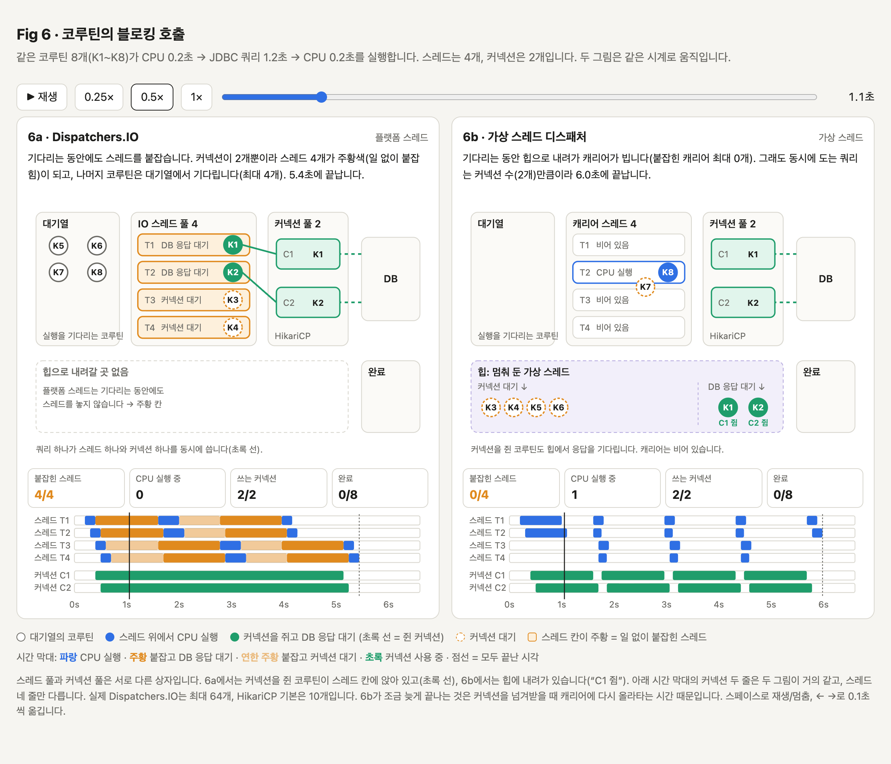

# 06. Kotlin 코루틴 vs 가상 스레드

[04. 가상 스레드](04-virtual-threads.md)를 읽었다고 가정합니다. Kotlin 서버에서 "가상 스레드를 쓰나, 코루틴을 쓰나", "스레드 풀과 커넥션 풀은 어떤 관계인가", "한 요청 안에서 병렬로 부르려면 무엇이 필요한가"가 헷갈려서 정리한 노트입니다.

## Kotlin과 Java는 같은 JVM 위에서 돕니다

Kotlin 코드도 컴파일하면 Java와 같은 바이트코드(`.class`)가 됩니다. 그래서 아래는 언어와 관계없이 같습니다.

- JVM, GC, Heap 구조
- 라이브러리: Spring, JPA, HikariCP를 그대로 씁니다
- 운영 문제: [05번 노트](05-jvm-upgrade-periodic-crash.md)의 OOMKilled, GC, 에이전트 문제는 Kotlin 서버에도 똑같이 생깁니다

다른 것은 언어 문법과 기능입니다.

| | Java | Kotlin |
|---|---|---|
| null | 아무 참조나 null이 될 수 있음 | `String`과 `String?`을 타입으로 구분해서, null 실수를 컴파일할 때 잡음 |
| 데이터 클래스 | `record` 또는 Lombok | `data class` |
| 비동기 | 가상 스레드(JDK 21), `CompletableFuture` | **코루틴**(`suspend fun`). 가상 스레드도 JVM 기능이라 그대로 쓸 수 있음 |

## 한 줄 요약

**둘 다 "기다리는 동안 OS 스레드를 놓아준다"는 같은 문제를 풉니다. 차이는 놓아주는 지점을 누가 정하느냐입니다.**

- **코루틴:** 개발자가 `suspend`로 표시한 지점에서만 놓아줍니다. Python의 **asyncio**(`async`/`await`)와 같은 방식입니다.
- **가상 스레드:** JVM이 I/O 지점에서 알아서 놓아줍니다. 코드는 평범한 블로킹 코드 그대로입니다. Python의 **gevent**와 같은 방식입니다.

나머지 차이는 대부분 여기서 나옵니다.

| | 코루틴 | 가상 스레드 |
|---|---|---|
| 놓아주는 지점 | `suspend` 함수 호출 지점(개발자가 표시) | 블로킹 I/O 지점(JVM이 처리) |
| 함수 색깔 | `suspend fun`은 코루틴 안에서만 부를 수 있음 | 구분 없음 |
| 블로킹 라이브러리(JDBC 등) | 그냥 부르면 아래 스레드를 막음 → 별도 스레드 풀로 보내야 함 | 그냥 불러도 됨(단, JDK 21~23의 pinning 주의) |
| 구현 | 컴파일러가 함수를 상태 기계로 바꿈. 스택을 따로 저장하지 않음 | JVM이 스레드 스택을 Heap에 복사해 두었다가 되살림 |
| 취소 | 구조적 동시성이 기본. 부모가 취소되면 자식도 취소 | `interrupt()` 기반. 구조적 동시성 API는 JDK 21에서 아직 미리보기 |
| 정식 출시 | 2018년(Kotlin 1.3) | 2023년(JDK 21) |

## 차이 1: 블로킹 라이브러리는 별도 스레드 풀로

코루틴은 `suspend` 지점에서만 스레드를 놓아줍니다. JDBC 같은 블로킹 호출은 `suspend`가 아니라서, 부르는 순간 **코루틴이 올라탄 스레드 자체가 멈춥니다.**

```kotlin
// 나쁜 예: CPU 작업용 스레드(코어 수만큼)를 JDBC 대기로 붙잡음
suspend fun getPost(id: Long): Post = withContext(Dispatchers.Default) {
    postRepository.findById(id)   // 블로킹 JDBC
}

// 좋은 예: 블로킹 전용 풀로 보냄
suspend fun getPost(id: Long): Post = withContext(Dispatchers.IO) {
    postRepository.findById(id)
}
```

- `Dispatchers.Default`는 CPU 코어 수만큼의 스레드로 계산 작업을 돌리는 풀입니다. 여기서 블로킹하면 코어 수만큼만 막혀도 서버 전체가 멈춥니다. **가상 스레드의 pinning과 같은 모양의 사고입니다.**
- `Dispatchers.IO`는 블로킹 호출용 풀입니다. 기본 크기는 **64개**(코어가 더 많으면 코어 수)입니다.
- 그래서 `Dispatchers.IO`의 64개가 사실상 **블로킹 호출의 동시 처리 상한**이 됩니다. 플랫폼 스레드 시절 Tomcat 스레드 200개와 같은 역할입니다. 상한이 있다는 점은 오히려 안전장치이기도 합니다([Spring 03. 동시 처리 상한](../spring/03-concurrency-limits.md)).
- 호출 대상마다 상한을 나누려면 `Dispatchers.IO.limitedParallelism(20)`처럼 쪼갭니다. 벌크헤드와 같은 생각입니다.

가상 스레드에서는 이 구분이 필요 없습니다. JDBC를 그냥 불러도 JVM이 캐리어를 놓아줍니다. 대신 상한이 사라지므로 직접 둬야 합니다.

## 차이 2: 함수 색깔

```kotlin
suspend fun fetchProfile(): Profile { ... }

fun handler() {
    fetchProfile()          // 컴파일 오류: suspend 함수는 코루틴 안에서만
}
```

- `suspend`는 호출하는 쪽으로 번집니다. 한 곳을 `suspend`로 바꾸면 그 함수를 부르는 함수도 모두 `suspend`가 되어야 합니다. Python에서 `async def`가 위로 번지는 것과 같습니다.
- 가상 스레드는 함수 색깔이 없어서, 기존 블로킹 코드를 고치지 않고 옵션만 켜면 됩니다. Spring MVC + JPA 같은 블로킹 스택에서 가상 스레드가 쉬운 이유입니다.

## 차이 3: 취소와 타임아웃

코루틴은 **구조적 동시성**이 기본입니다. 부모 코루틴이 취소되거나 타임아웃이 나면 그 안에서 시작한 자식 코루틴이 모두 같이 취소됩니다.

```kotlin
val feed = withTimeout(500) {          // 500ms 안에 못 끝나면 전부 취소
    val posts = async { loadPosts() }
    val ads = async { loadAds() }
    Feed(posts.await(), ads.await())
}
```

함정이 있습니다. **코루틴 취소는 협조 방식이라, 블로킹 호출은 멈추지 않습니다.**

- `withTimeout`이 났어도 `Dispatchers.IO`에서 돌던 JDBC 쿼리는 끝날 때까지 계속 돕니다. 커넥션과 IO 스레드도 계속 붙잡습니다.
- 그래서 블로킹 호출에는 자체 타임아웃을 따로 겁니다. JDBC 쿼리 타임아웃, HTTP 읽기 타임아웃입니다.
- 중단 가능한 블로킹 호출이라면 `runInterruptible(Dispatchers.IO) { ... }`로 감싸서, 취소될 때 스레드 interrupt를 보내게 할 수 있습니다.

가상 스레드는 JDK 21 기준으로 이런 구조적 취소가 기본이 아닙니다(`StructuredTaskScope`는 미리보기 기능). 취소는 `Future.cancel(true)`나 `interrupt()`로 직접 합니다.

## 디스패처가 정하는 것: 어느 스레드에서 도나

코루틴은 스스로 스레드를 고르지 않습니다. **디스패처가 정한 스레드에서만** 돕니다. Spring의 가상 스레드 옵션을 켜도 코루틴은 그 사실을 모릅니다.

| 디스패처 | 실제로 도는 곳 | 용도 |
|---|---|---|
| `Dispatchers.Default` | 플랫폼 스레드, 코어 수만큼 | CPU 계산, 논블로킹 라이브러리 |
| `Dispatchers.IO` | 플랫폼 스레드, 필요할 때 늘어 최대 64개 | 블로킹 호출(JDBC 등) |
| 가상 스레드 디스패처(직접 만듦) | 가상 스레드 → 캐리어(플랫폼 스레드, 코어 수만큼) | 블로킹 호출을 가상 스레드로 |

kotlinx.coroutines에는 가상 스레드용 기본 디스패처가 없어서, 실행기를 감싸 만듭니다. 앱에 하나만 만들어 공유합니다.

```kotlin
@Bean(destroyMethod = "close")
fun virtualThreadDispatcher(): ExecutorCoroutineDispatcher =
    Executors.newVirtualThreadPerTaskExecutor().asCoroutineDispatcher()
```

Spring Boot에서 가상 스레드 옵션을 켰다면, Spring이 만든 기본 작업 실행기(`applicationTaskExecutor`)도 가상 스레드를 씁니다. 그걸 `asCoroutineDispatcher()`로 감싸 써도 됩니다.

### 가상 스레드를 켜도 `suspend`는 그대로입니다

두 기능은 서로 다른 층에서 동작합니다.

```
코루틴      ── suspend 지점에서 "스레드"를 놓아줌        (Kotlin 컴파일러)
   ↓ 올라타 있음
가상 스레드  ── 블로킹 I/O에서 "캐리어"를 놓아줌         (JVM)
   ↓ 올라타 있음
캐리어 = 플랫폼 스레드 = OS 스레드
```

| 경우 | `suspend` 필요? | 블로킹 호출 |
|---|---|---|
| 코루틴만 | 필요 | `Dispatchers.IO`로 보냄 |
| 가상 스레드 옵션만 켜고 일반 `fun` 사용 | 불필요(코루틴 안 씀) | 그냥 부름 |
| 옵션을 켰지만 `suspend` + `Dispatchers.IO` 유지 | 필요 | 여전히 IO 풀의 플랫폼 스레드에서 돎(가상 스레드 효과 없음) |
| 코루틴 디스패처를 가상 스레드로 | 바깥은 필요(`withContext`가 suspend) | 블록 안에서 그냥 부름 |

**코루틴은 Kotlin의 필수 기능이 아닙니다.** `kotlinx.coroutines` 라이브러리라서, 넣지 않으면 없습니다. Kotlin + Spring MVC + JPA로 평범한 `fun`만 쓰는 서버도 많습니다.

## 스레드 풀과 커넥션 풀은 다른 자원입니다 (Fig 6)

헷갈리기 쉬운 부분입니다. 커넥션 풀이 스레드를 쓰는 것이 아니라, **코드를 실행 중인 스레드가 커넥션을 빌려 씁니다.** 쿼리 하나는 스레드 하나와 커넥션 하나를 **동시에** 씁니다.

| | 무엇의 풀인가 | 왜 미리 만들어 두나 |
|---|---|---|
| `Dispatchers.IO`, Tomcat 스레드 | 플랫폼 스레드 | 만들기 비싸고 메모리(스택)를 많이 써서 |
| HikariCP | DB 연결(TCP 소켓) | 맺기 비싸서(TCP 연결, 인증, 세션 준비) |

FastAPI로는 `def` 엔드포인트를 실행하는 스레드 풀(기본 40개)과 SQLAlchemy 커넥션 풀이 따로 있는 것과 같습니다.

[](https://kbj804.github.io/java-in-practice/study/jvm/figures/io-vs-vt/io-vt-light.html)

움직이는 버전: [라이트](https://kbj804.github.io/java-in-practice/study/jvm/figures/io-vs-vt/io-vt-light.html) · [다크](https://kbj804.github.io/java-in-practice/study/jvm/figures/io-vs-vt/io-vt.html). 위에서 내려다본 그림 두 장(6a, 6b)이 같은 시계로 나란히 움직입니다. 스레드 4개, 커넥션 2개를 두고, 같은 코루틴 8개(K1~K8)가 JDBC를 부릅니다. 스레드 풀과 커넥션 풀은 서로 다른 상자로 그렸습니다.

- **6a Dispatchers.IO:**
  - 커넥션을 쥔 코루틴(K1, K2)은 스레드 칸에 앉은 채 DB 응답을 기다립니다. 초록 선이 그 스레드와 커넥션을 잇습니다.
  - 커넥션을 못 받은 코루틴(K3, K4)도 스레드를 붙잡고 기다립니다. 스레드 4칸이 모두 주황(일 없이 붙잡힘)이 되어, 나머지는 대기열에 줄을 섭니다.
- **6b 가상 스레드 디스패처:** 같은 코루틴이 기다리는 동안 힙으로 내려갑니다. 커넥션을 쥔 코루틴도 마찬가지라서 캐리어 4칸이 비어 있습니다.
- **아래 시간 막대:** 커넥션 두 줄은 두 그림이 거의 같습니다. 동시에 도는 쿼리는 어느 쪽이든 커넥션 수(2)만큼이라 끝나는 시간도 비슷합니다(5.4초, 6.0초). 다른 것은 스레드 네 줄, 즉 기다리는 동안 스레드를 붙잡느냐뿐입니다.

그래서 실제 상한은 둘 중 작은 쪽입니다. IO 스레드 64개, 커넥션 20개면 동시에 도는 쿼리는 20개이고, 나머지 44개 스레드는 커넥션을 기다리며 막혀 있습니다. 그동안 IO 풀을 쓰는 다른 일(파일, 외부 HTTP)도 스레드를 못 받습니다. 그래서 DB 전용 디스패처를 커넥션 수에 맞춰 쪼갭니다.

```kotlin
val dbDispatcher = Dispatchers.IO.limitedParallelism(20)   // Hikari maximum-pool-size와 같게
```

### 트랜잭션은 스레드에 묶여 있습니다

- Spring의 JDBC/JPA 트랜잭션은 커넥션을 **현재 스레드**에 붙여 둡니다(ThreadLocal).
- 코루틴은 `suspend` 지점마다 스레드가 바뀔 수 있습니다. 트랜잭션 도중에 바뀌면 같은 트랜잭션으로 묶이지 않습니다.
- 그래서 **트랜잭션 전체를 하나의 `withContext` 블록 안에** 넣고, 그 안에서는 `suspend` 호출을 하지 않습니다.
- `suspend fun`에 `@Transactional`을 붙여 자연스럽게 쓰는 것은 R2DBC 같은 리액티브 트랜잭션에서만 제대로 동작합니다.

## 한 요청 안의 병렬 호출

**가상 스레드는 한 요청 안의 호출을 알아서 병렬로 만들어 주지 않습니다.** Java든 Kotlin이든 코드는 위에서 아래로 하나씩 실행됩니다. 가상 스레드가 싸게 만드는 것은 "요청 여러 개를 동시에 받는 것"이고, "요청 안의 병렬"은 개발자가 직접 씁니다.

```java
// Java: 순서대로 실행. 0.3초짜리 셋이면 0.9초
var posts = postRepository.findRecent();
var ads = adClient.fetch();
var profile = profileRepository.findMe();
```

### 병렬로 하려면

**Java (가상 스레드)**
```java
try (var executor = Executors.newVirtualThreadPerTaskExecutor()) {
    var posts = executor.submit(() -> postRepository.findRecent());
    var ads = executor.submit(() -> adClient.fetch());
    var profile = executor.submit(() -> profileRepository.findMe());
    return new Feed(posts.get(), ads.get(), profile.get());   // 약 0.3초
}
```

**Kotlin (코루틴 + 가상 스레드 디스패처)**
```kotlin
fun getFeed(): Feed = runBlocking(vt) {      // 요청 스레드가 이미 가상 스레드라 막혀도 괜찮음
    withTimeout(800) {                       // 하나라도 늦으면 전부 취소
        val posts = async { postRepository.findRecent() }
        val ads = async { runCatching { adClient.fetch() }.getOrElse { emptyList() } }  // 광고는 실패해도 됨
        val profile = async { profileRepository.findMe() }
        Feed(posts.await(), ads.await(), profile.await())
    }
}
```

**Spring `@Async` (실행기를 직접 만들지 않음)**: `@EnableAsync`를 켜고, 다른 빈의 메서드에 `@Async`를 붙여 `CompletableFuture`를 돌려받습니다. 가상 스레드 옵션을 켰다면 가상 스레드에서 돕니다. 같은 클래스 안에서 부르면 프록시를 안 거쳐 순서대로 실행됩니다.

### `submit` 할 때마다 무슨 스레드가 생기나

**executor는 일을 어디서 돌릴지 정하는 창구이고, 어떤 스레드를 쓰는지는 executor 종류가 정합니다.**

| 만드는 코드 | `submit` 하면 |
|---|---|
| `Executors.newFixedThreadPool(10)` | 미리 만든 플랫폼 스레드 10개 중 하나가 실행 |
| `Executors.newVirtualThreadPerTaskExecutor()` | `submit`마다 가상 스레드를 새로 하나 만들어 실행 |

가상 스레드 쪽은 `submit` 3번에 가상 스레드 3개가 생기고, **플랫폼 스레드(캐리어)는 하나도 늘지 않습니다.** 세 호출이 응답을 기다리는 동안 셋 다 캐리어에서 내려오므로, 캐리어는 그동안 다른 요청의 가상 스레드를 실행합니다([04번 노트의 Fig 4b](04-virtual-threads.md#fig-4b-가상-스레드)).

### 코루틴에 디스패처가 꼭 필요한 이유

```kotlin
fun getFeed(): Feed = runBlocking {                    // 디스패처 없음
    val posts = async { postRepository.findRecent() }  // 블로킹
    val ads = async { adClient.fetch() }               // 블로킹
    Feed(posts.await(), ads.await())
}
```

디스패처가 없으면 `runBlocking`은 **지금 스레드 하나**에서 코루틴들을 번갈아 돌립니다. 그런데 블로킹 호출은 `suspend`가 아니라서 끝날 때까지 스레드를 놓지 않습니다. **`async`를 써도 하나씩 순서대로 실행됩니다.** 각 `async`가 자기 스레드를 하나씩 가져야 블로킹 호출이 동시에 돌고, 그 스레드를 어디서 가져올지 정하는 것이 디스패처입니다.

### 병렬 호출의 주의점

- **커넥션을 동시에 여러 개 씁니다.** DB 호출 2개를 병렬로 하는 요청이 동시에 10개면 커넥션 20개가 필요합니다.
- **트랜잭션 안에서는 병렬로 하지 않습니다.** `async`로 다른 스레드에 보낸 호출은 트랜잭션 밖에서 실행됩니다. 병렬 조회는 읽기 전용 호출끼리만 합니다.
- `withTimeout`은 코루틴만 취소합니다. 각 호출 자체의 타임아웃(JDBC 쿼리 타임아웃, HTTP 읽기 타임아웃)도 겁니다.

## 가상 스레드는 블로킹 라이브러리를 위한 차선책인가

절반만 맞습니다. Java를 만든 쪽의 관점은 오히려 반대입니다([JEP 444](https://openjdk.org/jeps/444)의 동기).

1. 처음에는 **블로킹 + 요청당 스레드 하나**였습니다. 코드가 위에서 아래로 읽히고, 예외와 스택 트레이스가 깔끔하고, 디버거도 잘 붙었습니다.
2. 문제는 **플랫폼 스레드가 비싸다**는 것이었습니다. 동시 요청이 수만 개가 되면 스레드를 그만큼 만들 수 없었습니다.
3. 그래서 **논블로킹**(WebFlux, Reactor, 코루틴)이 나왔습니다. 적은 스레드로 많은 요청을 받습니다.
4. 대신 코드가 `Mono`, 콜백, `suspend`로 바뀌고, 스택 트레이스가 끊기고, 라이브러리를 전부 논블로킹 버전으로 바꿔야 했습니다.

가상 스레드는 **스레드를 싸게 만들어서 1번의 쉬운 방식으로 돌아가게** 한 것입니다. 블로킹 라이브러리를 다 바꿀 수 없다는 현실(JDBC와 JPA가 사실상 표준, R2DBC는 아직 덜 쓰임)도 큰 이유입니다.

둘은 같은 아이디어를 다른 층에서 구현했습니다.

| | 코루틴 + 논블로킹 라이브러리 | 가상 스레드 + 블로킹 라이브러리 |
|---|---|---|
| 실제 플랫폼 스레드 | `Dispatchers.Default`, 코어 수만큼 | 캐리어, 코어 수만큼 |
| 그 위에 올라타는 것 | 코루틴 수만 개 | 가상 스레드 수만 개 |
| 기다릴 때 놓아주는 주체 | `suspend` 함수(라이브러리가 지원해야 함) | JVM(블로킹 코드 그대로) |

비효율이 생기는 것은 그 중간인 **코루틴 + 블로킹 라이브러리 + `Dispatchers.IO`** 조합입니다. 스레드가 응답을 기다리며 막혀 있고 64개 상한이 생깁니다. 가상 스레드가 나오기 전에는 이것이 최선의 타협이었습니다.

논블로킹이 여전히 나은 곳도 있습니다.
- 스트리밍(SSE, WebSocket): 받는 쪽 속도에 맞춰 흘리는 기능(backpressure)이 내장돼 있습니다.
- 정교한 취소와 타임아웃: 코루틴의 구조적 동시성이 아직 더 편합니다.

Python으로는 asyncio(명시적 `await`, 코루틴의 길)와 gevent(블로킹 코드 그대로, 가상 스레드의 길)의 차이입니다. Java는 gevent의 길을 JVM이 공식으로 지원하는 쪽을 택했습니다.

## 결제처럼 정합성이 중요한 곳은

**정합성은 블로킹이냐 논블로킹이냐로 정해지지 않습니다.** DB 트랜잭션, 유니크 제약과 멱등 키, 락, Outbox, Saga와 대사(reconciliation)가 정합성을 지킵니다. 실행 모델이 바꾸는 것은 이 장치들을 얼마나 실수 없이 쓰기 쉬운가입니다.

- **블로킹 + JDBC + 가상 스레드가 다루기 쉽습니다.** 트랜잭션이 한 스레드에 묶여 있어서 `@Transactional` 범위가 코드 그대로 보입니다. JPA, 락, 드라이버가 오래 검증됐고, 장애 때 스택 트레이스가 끊기지 않습니다.
- **논블로킹(코루틴, 리액티브)에서는 실수 지점이 늘어납니다.**
  - 트랜잭션 도중 스레드가 바뀌는 문제(위 "트랜잭션은 스레드에 묶여 있습니다").
  - 취소 시점 문제. PG 승인 요청을 보낸 뒤 DB에 저장하기 전에 코루틴이 취소되면, 돈은 나갔는데 기록이 없는 상태가 됩니다.
- **어느 모델이든 "결과 모름"은 생깁니다.** PG 호출이 타임아웃 나면 승인됐는지 모릅니다. 그래서 다음을 실행 모델과 별개로 둡니다.
  - 승인 전에 결제 기록을 "요청" 상태로 먼저 저장
  - 멱등 키로 재요청이 두 번 승인되지 않게 하기
  - 결과를 모르면 상태 조회 API와 대사 배치로 확정
- 그래서 결제·주문처럼 정합성이 중요한 핵심 흐름은 **블로킹 + JDBC로 단순하게** 두는 경우가 많습니다. 논블로킹은 스트리밍이나 대량 팬아웃처럼 이점이 분명한 곳에 씁니다.

## 어떤 걸 쓰나

| 스택 | 보통의 선택 |
|---|---|
| Kotlin + WebFlux, Ktor 같은 논블로킹 스택 | 코루틴. 라이브러리가 이미 `suspend`를 지원하므로 가상 스레드는 거의 의미 없음 |
| Kotlin + Spring MVC + JPA(JDBC) 같은 블로킹 스택 | 가상 스레드 옵션을 켜고 평범한 `fun`으로. 병렬 호출이 필요한 곳만 코루틴 + 가상 스레드 디스패처, 또는 `@Async` |
| Java + Spring MVC | 가상 스레드. 병렬은 `submit`이나 `@Async` |
| CPU 계산 | `Dispatchers.Default`나 플랫폼 스레드 풀. 가상 스레드는 계산을 빠르게 하지 않음 |

어느 쪽이든 공통으로 할 일은 같습니다.

1. **모든 기다림에 타임아웃**을 둡니다. 코루틴의 `withTimeout`만 믿지 말고 블로킹 호출 자체에도 겁니다.
2. **동시 처리 상한**을 확인합니다. 코루틴은 `Dispatchers.IO` 크기, 가상 스레드는 커넥션 풀과 직접 둔 `Semaphore`, 벌크헤드입니다([Spring 03](../spring/03-concurrency-limits.md)).
3. **아래 스레드를 붙잡는 지점**을 찾습니다. 코루틴은 `Default`에서의 블로킹, 가상 스레드는 `synchronized` 안의 I/O(JDK 21~23)입니다.

## 출처

- [Kotlin 문서: Coroutines](https://kotlinlang.org/docs/coroutines-overview.html), [Coroutine context and dispatchers](https://kotlinlang.org/docs/coroutine-context-and-dispatchers.html), [Cancellation and timeouts](https://kotlinlang.org/docs/cancellation-and-timeouts.html)
- [JEP 444: Virtual Threads](https://openjdk.org/jeps/444), [JEP 453: Structured Concurrency (Preview)](https://openjdk.org/jeps/453)
