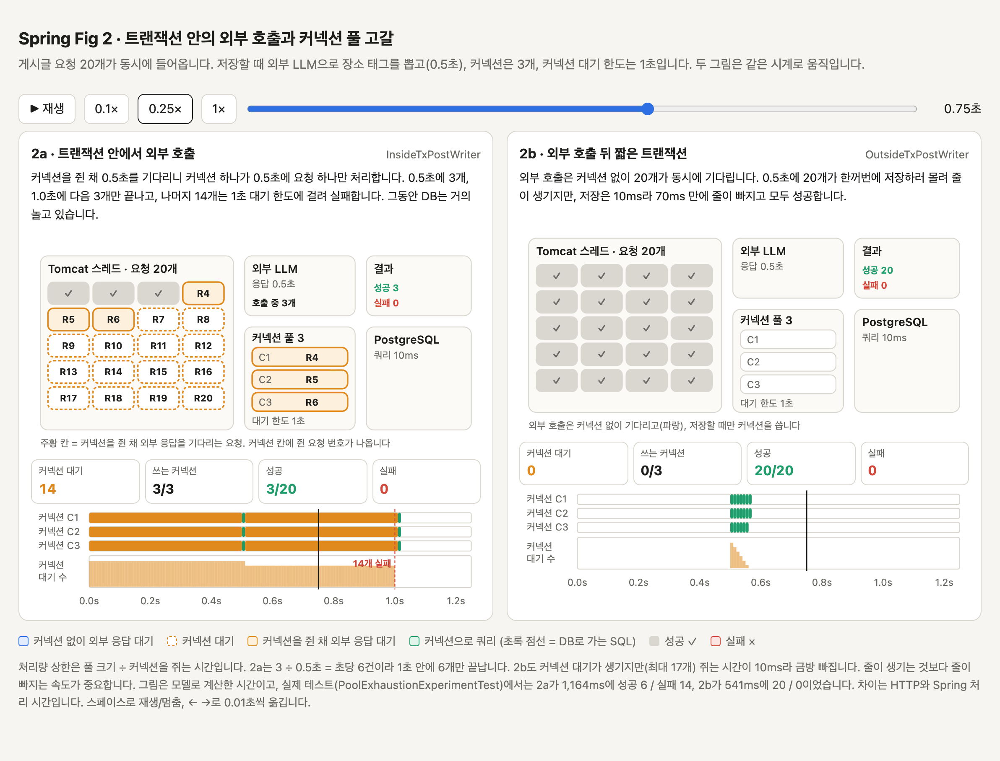

# 02. 실험 ①: 트랜잭션 안의 외부 호출과 커넥션 풀 고갈

장애 상황 훈련: 데이터베이스 자체는 여유가 있는데 커넥션 풀이 소진되면서 전체 API 요청이 지연되고 실패하는 상황을 재현합니다.

## 조건

- HikariCP 풀 **3개**, 커넥션 대기 한도(`connection-timeout`) **1초**
- 게시글 저장 + 가짜 외부 LLM 장소 태깅 **0.5초**
- 동시 요청 **20개**
- 실습: Kotlin + Spring Boot 4, Testcontainers Postgres로 재현 (Java 버전은 problems/로 옮길 예정)
- 실습 코드: [lab/step02-connection-pool](lab/step02-connection-pool) (`PoolExperiment.kt`, `PoolExhaustionExperimentTest`)

[](https://kbj804.github.io/java-in-practice/study/spring/figures/step02-connection-pool/index-light.html)

움직이는 버전: [라이트](https://kbj804.github.io/java-in-practice/study/spring/figures/step02-connection-pool/index-light.html) · [다크](https://kbj804.github.io/java-in-practice/study/spring/figures/step02-connection-pool/index.html). 두 그림은 아래 실험을 모델로 다시 계산해서, 테스트와 같은 6 / 14, 20 / 0이 나옵니다.

## 결과

| | 걸린 시간 | 성공 / 실패 | 커넥션 기다린 스레드 최대 |
|---|---|---|---|
| 나쁜 버전 (트랜잭션 안에서 외부 호출) | 1,158ms | **6 / 14** | 17 |
| 좋은 버전 (외부 호출 먼저, 저장만 트랜잭션) | 536ms | **20 / 0** | 0~14 (실행마다 다름) |

나쁜 버전에서 운영 로그에 찍히는 메시지 그대로:

```
HikariPool-1 - Connection is not available, request timed out after 1004ms (total=3, active=3, idle=0, waiting=11)
```

이 줄을 보면 바로 풀 고갈이다. `active=3, idle=0`이면 커넥션이 전부 누군가에게 잡혀 있고, `waiting`이 줄을 선 스레드 수다.

## 왜 6개만 성공했나

- 0초: 3개가 커넥션을 잡고 0.5초 동안 외부 호출을 기다린다. 나머지 17개는 줄을 선다.
- 0.5초: 3개가 끝나고, 다음 3개가 커넥션을 잡는다.
- 1.0초: 줄 선 나머지 14개가 1초 대기 한도에 걸려 실패한다. 이때 DB는 거의 놀고 있다.

처리량 상한은 `풀 크기 ÷ 커넥션을 쥐는 시간`이다. 3 ÷ 0.5초 = 초당 6건. 쿼리는 몇 ms인데 외부 호출 때문에 커넥션 하나를 쥐는 시간이 100배가 됐다.

## 좋은 버전에서도 대기가 생기는 이유

20개 요청이 외부 호출(0.5초)을 **동시에** 끝내고 한꺼번에 저장하러 몰리기 때문이다. 하지만 저장 트랜잭션은 몇 ms라서 줄이 금방 빠지고 전부 성공했다. 대기 시간이 몇 ms뿐이라 20ms마다 재는 테스트에는 잡힐 때(14)도 있고 안 잡힐 때(0)도 있다. 줄이 생기는 것 자체가 문제가 아니라, **줄이 빠지는 속도(커넥션을 쥐는 시간)**가 문제다.

## Python에서도 같은 문제가 있었나?

있다. FastAPI에서 `async with session.begin():` 안에서 `await httpx.get(...)`을 하면 똑같이 커넥션을 쥔 채로 기다린다. 30초 홈쇼핑의 느린 외부 상품 API가 트랜잭션 안에 있었다면 같은 장애가 났을 것이다. JVM이라서 달라지는 건 이 부분이다.

- **줄 서는 주체가 스레드다.** Tomcat은 요청마다 스레드를 하나 쓴다(기본 200개). 스레드 200개가 커넥션 10개(Hikari 기본값)를 두고 줄을 선다. 줄 서 있는 스레드는 다른 요청도 못 받으니, 결국 Tomcat 스레드까지 바닥나서 헬스체크마저 느려질 수 있다.
- **가상 스레드(Java 21)로는 해결되지 않는다.** 스레드가 싸져서 동시 요청이 더 많이 들어오면, 같은 풀 앞에 줄만 더 길어진다. 병목은 스레드가 아니라 커넥션이다.
- **`open-in-view`를 켜 두면** 트랜잭션이 끝나도 응답을 쓸 때까지 커넥션을 쥔다. 트랜잭션을 아무리 짧게 해도 소용이 없다. 그래서 꺼 두었다([Spring 01](01-spring-basics.md)).

## 정리: 설계할 때 지킬 것

1. **외부 호출은 트랜잭션 밖으로.** 결과가 저장에 꼭 필요하면 먼저 호출하고(이번 좋은 버전), 필요 없으면 커밋 후 이벤트로 뒤로 보낸다. 커밋 후 이벤트가 사라지는 틈은 [04. Transactional Outbox](04-transactional-outbox.md)에서 다룬다. 결제 Saga에서 PG 승인을 블록으로 분리했던 것과 같은 생각이다.
2. **외부 호출에는 반드시 타임아웃.** 0.5초가 30초가 되면 풀도 30초 동안 막힌다. 회로 차단기는 다음 노트에서 다룬다.
3. **풀 크기를 무작정 키우지 않는다.** DB가 감당할 커넥션 수는 정해져 있고(`Pod 수 × 풀 크기`가 DB `max_connections`를 넘으면 안 됨), 커넥션이 많다고 빨라지지 않는다. HikariCP 문서의 출발점은 `코어 수 × 2 + 디스크 수` 정도다.
4. **지표로 미리 본다.** Actuator가 `hikaricp.connections.pending`(대기 스레드), `hikaricp.connections.active`, `hikaricp.connections.acquire`(커넥션 얻는 데 걸린 시간)를 내보낸다. pending이 0보다 커지기 시작하면 장애 전 신호다.
