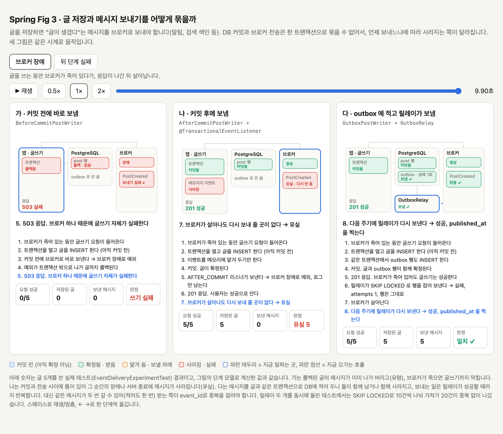

# 04. 실험 ②: 커밋 후 이벤트 유실과 Transactional Outbox

장애 상황 훈련: 글은 저장됐는데 "글이 생겼다"는 메시지가 사라져 알림·검색 색인이 빠지는 상황, 거꾸로 롤백된 글의 메시지가 나가 버리는 상황을 재현하고 outbox로 막습니다.

[02. 커넥션 풀 고갈](02-connection-pool.md)의 정리 1번에서 "결과가 저장에 필요 없는 외부 호출은 커밋 후 이벤트로 뒤로 보낸다"고 했습니다. 이 노트는 그 "커밋 후"에 생기는 틈을 다룹니다.

## 문제: DB 커밋과 메시지 전송은 한 트랜잭션이 아닙니다

글 저장은 PostgreSQL 트랜잭션이고, 메시지 전송은 브로커(RabbitMQ, Kafka 등)로 가는 네트워크 호출입니다. 둘을 한 번에 커밋하는 방법이 없어서(이중 쓰기 문제, dual write), 어느 쪽을 먼저 하든 그 사이에 장애가 나면 한쪽만 남습니다.

| 방법 | 코드 | 사이에 장애가 나면 |
|---|---|---|
| 가. 커밋 전에 바로 보냄 | 트랜잭션 안에서 `broker.publish()` | 롤백돼도 메시지는 이미 나감 → **유령 메시지**. 브로커가 죽으면 글쓰기까지 실패 |
| 나. 커밋 후에 보냄 | `@TransactionalEventListener(phase = AFTER_COMMIT)` | 커밋 직후 브로커 장애·서버 종료 → **유실**. 다시 보내 줄 곳이 없음 |
| 다. Transactional Outbox | 글과 같은 트랜잭션으로 `outbox_event` 행 INSERT, 릴레이가 따로 전송 | 글과 메시지가 함께 남거나 함께 사라짐. 전송은 성공할 때까지 재시도 |

## 조건

- 실습 코드: [lab/step03-transactional-outbox](lab/step03-transactional-outbox) (`EventExperiment.kt`, `outbox/`, `EventDeliveryExperimentTest`)
- 브로커는 메모리에 쌓는 대역(`MessageBroker`)으로, `down`을 켜면 장애처럼 예외를 던집니다. 다음 단계에서 RabbitMQ로 바꿉니다.
- 방법마다 글 **5개**, 두 상황
  - **브로커 장애**: 글을 쓰는 동안 브로커가 죽어 있다가 다 쓴 뒤 살아남. 그 뒤 릴레이 1회
  - **뒤 단계 실패**: 메시지를 맡긴 뒤 같은 트랜잭션의 다음 단계가 실패해 롤백

[](https://kbj804.github.io/java-in-practice/study/spring/figures/step03-transactional-outbox/index-light.html)

움직이는 버전: [라이트](https://kbj804.github.io/java-in-practice/study/spring/figures/step03-transactional-outbox/index-light.html) · [다크](https://kbj804.github.io/java-in-practice/study/spring/figures/step03-transactional-outbox/index.html). 위 버튼으로 두 상황을 바꿀 수 있고([뒤 단계 실패 화면](figures/step03-transactional-outbox/figure-rollback-light.png)), 그림의 단계 모델로 계산한 결과가 아래 테스트 숫자와 같지 않으면 그림 빌드가 멈춥니다.

## 결과

| 방법 · 상황 | 요청 성공 | 저장된 글 | 보낸 메시지 | 유실 | 유령 |
|---|---|---|---|---|---|
| 가 · 브로커 장애 | **0/5** | 0 | 0 | 0 | 0 |
| 가 · 뒤 단계 실패 | 0/5 | 0 | 5 | 0 | **5** |
| 나 · 브로커 장애 | 5/5 | 5 | 0 | **5** | 0 |
| 나 · 뒤 단계 실패 | 0/5 | 0 | 0 | 0 | 0 |
| 다 · 브로커 장애 | 5/5 | 5 | 5 | 0 | 0 |
| 다 · 뒤 단계 실패 | 0/5 | 0 | 0 | 0 | 0 |

나 · 브로커 장애에서 운영 로그에 찍히는 줄 그대로. 사용자는 201을 받았고, 에러는 로그에만 남습니다.

```
ERROR o.s.t.s.TransactionSynchronizationUtils : TransactionSynchronization.afterCompletion threw exception
kr.aloui.community.message.BrokerUnavailableException: message broker unavailable
```

`afterCompletion`은 커밋이 끝난 뒤라 되돌릴 트랜잭션이 없습니다. Spring은 예외를 삼키고 로그만 남깁니다.

## 왜 나(AFTER_COMMIT)는 안전해 보이는데 유실되나

`@TransactionalEventListener(AFTER_COMMIT)`은 "롤백된 글의 메시지는 안 보낸다"는 가의 문제는 풉니다(나 · 뒤 단계 실패가 0 / 0). 하지만 이벤트가 **메모리**에만 있습니다.

- 커밋 직후 브로커가 죽어 있으면: 예외가 로그로 끝나고, 이벤트는 그 요청 스레드와 함께 사라집니다.
- 커밋 직후 배포·OOM으로 서버가 꺼지면: 리스너가 불리기도 전에 사라집니다. 이건 테스트로 재현하지 않았지만 같은 틈입니다.
- 리스너에 재시도를 붙여도 메모리 안의 재시도라 서버가 꺼지면 같이 사라집니다.

결국 "보내야 할 메시지"를 커밋과 같은 곳(DB)에 적어 두지 않으면 틈은 남습니다.

## 다(outbox)는 어떻게 동작하나

1. 글 INSERT와 `outbox_event` INSERT를 **같은 트랜잭션**에서 합니다. 커밋되면 둘 다 남고, 롤백되면 둘 다 사라집니다.
2. `OutboxRelay`가 1초마다 `published_at is null`인 행을 오래된 순으로 잠가 가져와 브로커로 보내고, 보낸 행에 `published_at`을 찍습니다.
3. 보내다 실패하면 `attempts`를 올리고 `last_error`를 적은 뒤 그 행은 그대로 둡니다. 다음 주기에 다시 보냅니다.

릴레이가 가져오는 쿼리는 Spring Data JPA로 이렇게 씁니다.

```kotlin
@Lock(LockModeType.PESSIMISTIC_WRITE)
@QueryHints(QueryHint(name = "jakarta.persistence.lock.timeout", value = "-2")) // -2 = SKIP LOCKED
@Query("select e from OutboxEvent e where e.publishedAt is null order by e.id")
fun lockUnpublished(limit: Limit): List<OutboxEvent>
```

Hibernate가 PostgreSQL로 보내는 SQL(테스트 로그):

```sql
select ... from step03.outbox_event oe1_0 where oe1_0.published_at is null order by oe1_0.id
fetch first ? rows only for no key update of oe1_0 skip locked
```

### 릴레이를 여러 개 띄우면: SKIP LOCKED

서버가 여러 대면 릴레이도 여러 개 돕니다. 그냥 `FOR UPDATE`면 두 번째 릴레이는 첫 번째가 잠근 행을 기다리고, 잠그지 않으면 같은 행을 둘이 보냅니다. `SKIP LOCKED`는 남이 잠근 행을 건너뛰고 다음 행을 가져갑니다.

테스트(`릴레이 두 개가 동시에 돌아도 ...`): outbox 행 20개, 한 번에 5개씩, 한 건 보내는 데 20ms인 상태로 릴레이 두 개를 동시에 돌렸더니 **각각 10건씩** 나눠 가져가 브로커가 받은 메시지는 20건, 서로 다른 id 20개(중복 0)였습니다.

`for no key update`는 `for update`보다 약한 잠금입니다. outbox 행의 키를 바꾸지 않으니 이걸로 충분하고, 외래 키로 이 행을 참조하는 INSERT를 막지 않습니다.

## outbox가 새로 만드는 숙제

- **적어도 한 번(at-least-once).** 브로커에 보냈는데 `published_at`을 찍는 커밋 직전에 서버가 꺼지면, 다음 주기에 같은 메시지를 또 보냅니다. 그래서 메시지마다 `event_id`(UUID)를 넣고, 받는 쪽이 처리한 id를 기록해 중복을 거릅니다(멱등 소비자). "정확히 한 번"은 보내는 쪽만으로는 만들 수 없습니다. → [05. inbox 와 리스](05-rabbitmq-inbox.md)에서 RabbitMQ 로 풉니다.
- **릴레이도 트랜잭션 안에서 외부 호출을 합니다.** 행을 잠근 채 브로커로 보내니 [02](02-connection-pool.md)에서 본 "커넥션을 쥔 채 기다리기"입니다. 한 번에 잡는 개수를 작게(여기선 100), 브로커 호출 타임아웃을 짧게 둡니다. 더 줄이려면 "잠그고 상태만 SENDING으로 바꿔 커밋 → 보내기 → 결과 기록"으로 나누는데, 그러면 SENDING에서 멈춘 행을 되살리는 처리가 따로 필요합니다.
- **지연.** 메시지가 최대 폴링 주기(1초)만큼 늦게 나갑니다. 더 줄여야 하면 폴링 대신 DB 로그를 읽는 CDC(Debezium의 outbox event router)를 씁니다.
- **순서.** 한 릴레이 안에서는 id 순이지만, 릴레이가 여럿이면 서로 다른 행은 순서가 섞일 수 있습니다. 같은 글의 이벤트 순서가 중요하면 Kafka 파티션 키를 글 id로 두는 식으로 받는 쪽 순서를 맞춥니다.
- **청소.** 보낸 행이 계속 쌓이니 며칠 지난 `published_at` 행을 지우는 배치가 필요합니다.
- **끝내 못 보내는 행.** `attempts`가 일정 횟수를 넘으면 알림을 보내고 사람이 봅니다. 이 실습에서는 아직 상한이 없습니다.

## Python에서는?

- Django의 `transaction.on_commit(lambda: task.delay(...))`가 나(AFTER_COMMIT)와 같습니다. 커밋 직후 Celery 브로커가 죽어 있으면 똑같이 사라집니다.
- SQLAlchemy에서 `session.commit()` 다음 줄에 `producer.send()`를 두는 것도 나와 같고, `commit()` 앞에 두면 가와 같습니다.
- outbox는 프레임워크와 상관없이 같은 모양입니다. 같은 세션에서 outbox 행을 add하고, 별도 워커가 `SELECT ... FOR UPDATE SKIP LOCKED`로 가져가 보냅니다. Spring에서는 그 워커가 `@Scheduled` 메서드 하나와 `@Transactional`, 잠금 힌트 하나로 끝납니다.

## 정리: 설계할 때 지킬 것

1. **"저장하고 알린다"가 있으면 이중 쓰기 문제부터 의심한다.** 커밋 전 전송은 유령, 커밋 후 전송은 유실을 만든다.
2. **보낼 메시지는 업무 데이터와 같은 트랜잭션으로 DB에 적는다(outbox).** 전송은 릴레이가 따로, 성공할 때까지.
3. **여러 릴레이는 `FOR UPDATE SKIP LOCKED`로 나눠 가진다.**
4. **받는 쪽은 `event_id`로 중복을 거른다.** outbox는 적어도 한 번이다.
5. **지표로 본다.** 아직 안 보낸 행 수(`countByPublishedAtIsNull`)와 가장 오래된 미전송 행의 나이가 늘기 시작하면 브로커나 릴레이 장애다.

## 출처

- [Spring Framework 문서: Transaction-bound Events](https://docs.spring.io/spring-framework/reference/data-access/transaction/event.html)
- [microservices.io: Transactional outbox](https://microservices.io/patterns/data/transactional-outbox.html)
- [PostgreSQL 문서: SELECT 의 Locking Clause (SKIP LOCKED)](https://www.postgresql.org/docs/17/sql-select.html#SQL-FOR-UPDATE-SHARE)
- [Debezium: Outbox Event Router](https://debezium.io/documentation/reference/stable/transformations/outbox-event-router.html)
