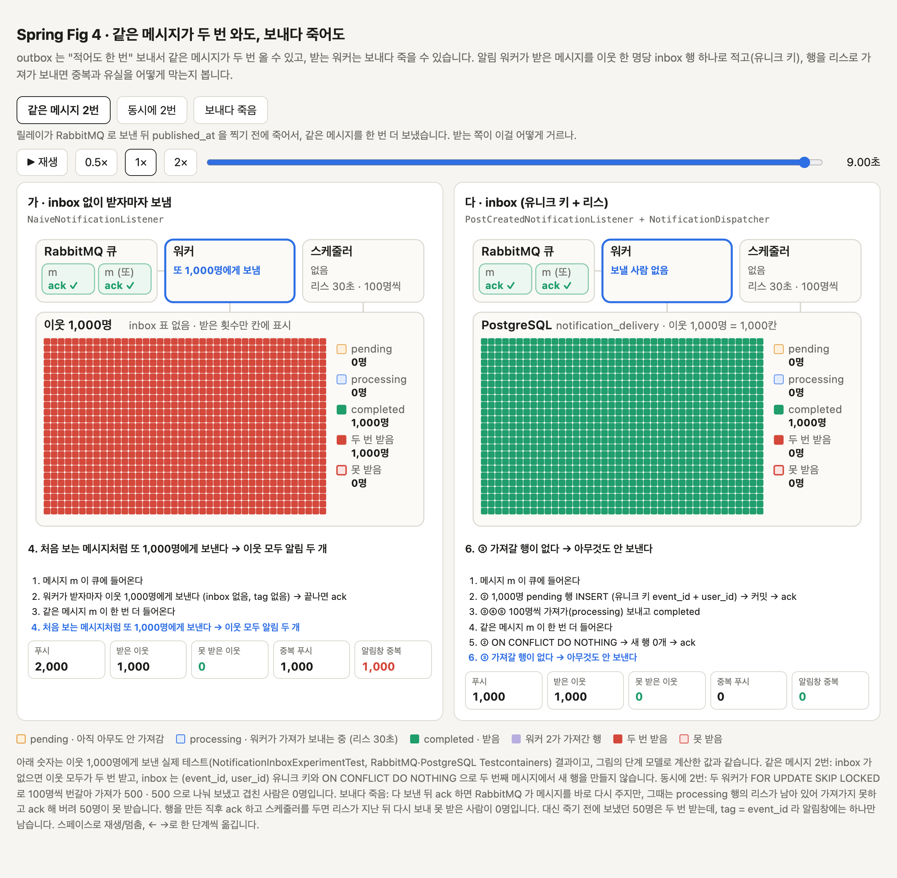

# 05. 실험 ③: RabbitMQ 로 받은 이벤트를 두 번 처리하지 않기 (inbox 와 리스)

장애 상황 훈련: 글이 올라오면 같은 동네 이웃 1,000명에게 알림을 보냅니다. 같은 메시지가 두 번 오거나, 두 워커가 동시에 받거나, 보내던 워커가 죽어도 **이웃마다 알림이 정확히 하나만 보이게** 만듭니다.

[04. Transactional Outbox](04-transactional-outbox.md)의 숙제 1번 "outbox 는 적어도 한 번이니 받는 쪽이 event_id 로 거른다"를 실제 RabbitMQ 로 풉니다.

## 문제: 보내는 쪽은 "적어도 한 번"까지만 약속합니다

- 릴레이가 RabbitMQ 로 보낸 뒤 `published_at` 을 찍는 커밋 직전에 죽으면, 다음 주기에 같은 메시지를 또 보냅니다.
- 워커 서버는 여러 대라, 같은 메시지 두 개가 서로 다른 워커에 동시에 들어갈 수 있습니다.
- 워커는 1,000명에게 보내는 도중에 배포나 OOM 으로 죽을 수 있습니다.
- 푸시를 보내는 외부 서비스(FCM)는 같은 요청을 걸러 주지 않습니다. 두 번 보내면 두 번 도착합니다.

## 설계를 정한 순서

질문 하나에 결정 하나씩 붙였습니다. 앞 결정의 빈틈이 다음 질문이 됩니다.

| 질문 | 결정 | 남은 빈틈 |
|---|---|---|
| 같은 메시지가 두 번 오면? | `event_id` 로 거른다. 이웃 한 명당 행 하나(`pending`→`completed`) | 보내고 `completed` 로 바꾸기 전에 죽으면? |
| 그 행은 보냈나, 안 보냈나? | 알 수 없다. 알림은 유실보다 중복이 나으니 **다시 보낸다**. 대신 푸시 `tag` 에 `event_id` 를 넣어 휴대폰 알림창에서 덮어쓰게 한다 | 두 워커가 동시에 "처음 보는 메시지"라고 판단하면? |
| 동시에 들어오면? | 조회 후 INSERT 는 경쟁 상태. **유니크 키 (event_id, user_id)** 에 판정을 맡긴다 | 1,000행을 한 트랜잭션에 넣다 한 행이 충돌하면? |
| 한 행이 충돌하면? | 예외면 트랜잭션 전체가 롤백되고 메시지가 계속 돈다. `ON CONFLICT DO NOTHING` | 남은 `pending` 을 누가 가져가나? 동시에 가져가면? |
| 누가 어떤 행을 보내나? | `FOR UPDATE SKIP LOCKED` 로 잠그면 살아 있는 워커의 행은 건너뛴다. 하지만 잠근 채 1,000건 보내면 커넥션을 쥔다([02](02-connection-pool.md)) | 잠금을 풀면 "처리 중" 표시도 사라진다 |
| 커넥션 없이 "처리 중"을 남기려면? | 행에 `processing` + `claimed_at`. **리스(30초)** 가 지나면 다른 워커가 다시 가져간다 | 리스가 끝났을 때 누가 다시 가져가나? |
| 리스 뒤 회수는 누가? | 메시지 재전달은 너무 일찍 온다(아래 실험 나). DB 를 진실로 두고 **스케줄러**가 돌아본다 | ack 는 언제? |
| ack 는 언제? | 행을 만든 커밋 **뒤에 바로**. 그 뒤의 일은 모두 DB 행으로 남았다 | |

받는 쪽에 둔 이 표를 **inbox** 라고 부릅니다. 보내는 쪽은 outbox, 받는 쪽은 inbox, 둘 다 "DB 행 + 스케줄러"로 적어도 한 번을 지킵니다.

## 동작

| 단계 | 하는 일 | 트랜잭션 |
|---|---|---|
| ① 받기 | `@RabbitListener` 가 메시지 수신. `messageId` = outbox 의 `event_id` | |
| ② 행 만들기 | 동네 이웃 수만큼 `pending` INSERT, `ON CONFLICT DO NOTHING` → **커밋 뒤 ack** | 짧게 |
| ③ 가져가기 | `pending` 이거나 리스가 지난 `processing` 을 100명씩 `processing` + `claimed_at` 으로 바꾸고 그 행을 돌려받음 | 짧게 |
| ④ 보내기 | FCM 호출, `tag = event_id` | 없음 (커넥션 안 쥠) |
| ⑤ 끝내기 | `completed` | 짧게 |

③④⑤는 ② 직후 리스너가 한 번, 그 뒤로는 `NotificationSweeper` 가 5초마다 돌립니다.

```sql
-- ② 행 만들기
insert into notification_delivery (event_id, post_id, user_id, state, created_at)
select :eventId, :postId, m.user_id, 'pending', :now
from region_member m where m.region_id = :regionId
on conflict (event_id, user_id) do nothing

-- ③ 가져가기
update notification_delivery set state = 'processing', claimed_at = :now
where id in (
    select id from notification_delivery
    where state = 'pending' or (state = 'processing' and claimed_at < :leaseExpiredBefore)
    order by id limit :limit
    for update skip locked
)
returning id, event_id, post_id, user_id
```

시각은 DB 의 `now()` 대신 주입받은 `Clock` 으로 넘깁니다. 테스트에서 시계를 31초 돌려 "리스가 지난 상황"을 만들 수 있고, 서버 간 시계 오차(NTP 로 ms 단위)는 리스 30초보다 훨씬 작습니다.

## 조건

- 실습 코드: [lab/step04-rabbitmq-inbox](lab/step04-rabbitmq-inbox) (`notification/`, `message/EventPublisher.kt`, `NotificationInboxExperimentTest`)
- RabbitMQ 4.1 · PostgreSQL 17 을 Testcontainers 로 띄웁니다. 푸시만 대역(`FakePushSender`)이고, 보낸 푸시와 `tag` 를 기록합니다.
- 이웃 1,000명, 한 번에 100명씩 가져감, 리스 30초. "서버가 죽음"은 350번째 푸시 뒤에 `Error` 를 던져 흉내 냅니다. `Exception` 이 아니라서 `catch (e: Exception)` 에 안 잡히고 `completed` 로 바꾸는 코드도 돌지 않습니다.

[](https://kbj804.github.io/java-in-practice/study/spring/figures/step04-rabbitmq-inbox/index-light.html)

움직이는 버전: [라이트](https://kbj804.github.io/java-in-practice/study/spring/figures/step04-rabbitmq-inbox/index-light.html) · [다크](https://kbj804.github.io/java-in-practice/study/spring/figures/step04-rabbitmq-inbox/index.html). 이웃 한 명이 한 칸입니다. 위 버튼으로 세 장면을 바꿀 수 있습니다([보내다 죽음](figures/step04-rabbitmq-inbox/figure-crash-light.png) · [동시에 2번](figures/step04-rabbitmq-inbox/figure-concurrent-light.png)). 그림의 단계 모델로 계산한 결과가 아래 테스트 숫자와 다르면 그림 빌드가 멈춥니다.

## 결과

| 장면 · 방법 | 푸시 | 받은 이웃 | 못 받은 이웃 | 중복 푸시 | 알림창 중복 |
|---|---|---|---|---|---|
| 글쓰기 → outbox → RabbitMQ → inbox | 1,000 | 1,000 | 0 | 0 | 0 |
| 같은 메시지 2번 · 가 inbox 없음 | 2,000 | 1,000 | 0 | 1,000 | **1,000** |
| 같은 메시지 2번 · 다 inbox | 1,000 | 1,000 | 0 | 0 | 0 |
| 동시에 2번 · 다 inbox (워커별 500 · 500) | 1,000 | 1,000 | 0 | 0 | 0 |
| 보내다 죽음 · 나 다 보낸 뒤 ack, 스케줄러 없음 | 950 | 950 | **50** | 0 | 0 |
| 보내다 죽음 · 다 행 만든 직후 ack + 스케줄러 | 1,050 | 1,000 | 0 | 50 | 0 |

### 나는 왜 50명을 놓치나

1. 300명을 보내고, 4번째 묶음 100명을 `processing` 으로 가져가 50명에게 보낸 뒤 죽습니다.
2. ack 전이었으니 RabbitMQ 가 메시지를 **바로** 다시 줍니다.
3. 새 워커의 ② 는 새 행 0개, ③ 은 `pending` 600명만 가져갑니다. `processing` 100명은 리스가 30초 남아 건너뜁니다.
4. 가져갈 행이 없으니 ack 합니다. 메시지가 지워져서, 리스가 끝나도 그 100명(그중 아직 못 받은 50명)을 다시 꺼낼 계기가 없습니다.

"메시지가 다시 와야 회수가 일어난다"는 구조라서 생긴 틈입니다. 회수의 계기를 메시지가 아니라 DB 를 보는 스케줄러에 두면 닫힙니다.

### 다는 왜 50명이 두 번 받나

죽기 전에 보냈지만 `completed` 로 바꾸지 못한 50명은, 리스가 지난 뒤 스케줄러가 다시 보냅니다. 이 틈은 어떤 설계로도 0이 되지 않습니다(외부 호출과 DB 기록은 한 트랜잭션이 아닙니다). 그래서 유실 대신 중복을 고르고, `tag = event_id` 로 휴대폰 알림창에서는 하나만 보이게 했습니다.

## Spring 에서 걸린 것

- **스타터 이름.** Spring Boot 4 에서 RabbitMQ(AMQP 0-9-1)용은 `spring-boot-starter-rabbitmq` 입니다. `spring-boot-starter-amqp` 는 AMQP 1.0 범용 클라이언트(Qpid)로 바뀌었습니다.
- **ack 시점을 코드에 드러내기.** `@RabbitListener(ackMode = "MANUAL")` 로 받고 ② 의 커밋 뒤에 `channel.basicAck` 를 부릅니다. 기본(AUTO)은 리스너 메서드가 정상으로 끝난 뒤 ack 해서, ④ 까지 리스너 안에서 하면 "다 보낸 뒤 ack"(나)가 됩니다.
- **prefetch 1.** 기본 250이면 컨슈머 하나가 메시지를 몰아 받아, 두 워커가 동시에 처리하는 장면이 안 나옵니다. 오래 걸리는 메시지는 작게 둡니다.
- **publisher confirm.** 릴레이는 `publisher-confirm-type: simple` 과 `waitForConfirmsOrDie` 로 브로커가 받았다는 확인까지 기다린 뒤에 `published_at` 을 찍습니다.
- **RETURNING 은 JPA 네이티브 쿼리로.** HQL 에는 `RETURNING` 이 없습니다. 리포지토리의 `@Query(nativeQuery = true)` 에 `@Modifying` 을 **달지 않으면** UPDATE ... RETURNING 의 결과 행을 SELECT 처럼 받습니다(`@Modifying` 을 달면 바뀐 행 수만 받음). 인터페이스 프로젝션의 getter 이름과 맞추려고 열 별칭을 `as "eventId"` 처럼 따옴표로 씁니다.
- **네이티브 SQL 과 스키마.** 테스트에서 Testcontainers 가 datasource url 을 덮어써 `?currentSchema=step04` 가 사라지고, 네이티브 SQL 이 표를 못 찾았습니다. `spring.datasource.hikari.schema: step04` 로 커넥션마다 스키마를 정했습니다.
- **트랜잭션 경계.** `NotificationDispatcher.dispatch()` 에는 `@Transactional` 이 없습니다. ③ 과 ⑤ 는 리포지토리 메서드마다 짧은 트랜잭션이고, ④ 동안은 커넥션을 쥐지 않습니다.

## inbox 가 새로 만드는 숙제

- **리스 길이.** 한 묶음을 보내는 최악의 시간보다 길어야 합니다. 짧으면 살아 있는 워커의 행을 뺏어 중복, 길면 죽었을 때 지연입니다. FCM 타임아웃 × 묶음 크기로 정하고, 묶음을 작게 해서 리스를 줄입니다.
- **늦게 끝난 워커.** 리스가 지나 다른 워커가 다시 가져간 뒤 원래 워커가 `completed` 를 찍을 수 있습니다. 알림은 해가 없지만, 결과가 중요한 작업이면 `claimed_at` 이 내가 찍은 값일 때만 끝내기(펜싱 토큰)로 막습니다.
- **끝내 못 보내는 행.** 지금은 실패하면 리스 뒤 무한히 다시 보냅니다. `attempts` 상한과 실패 표시, 알림이 필요합니다.
- **독이 든 메시지.** ② 에서 예외(잘못된 JSON 등)가 나면 ack 를 못 해 같은 메시지가 계속 돕니다. 재시도 횟수를 넘기면 데드레터 큐로 보냅니다.
- **라우팅 안 되는 메시지.** publisher confirm 은 큐에 못 들어간(바인딩 없는) 메시지도 "받았다"고 합니다. `mandatory` 와 반환 콜백으로 잡아야 합니다.
- **청소.** `completed` 행이 이웃 수 × 글 수만큼 쌓입니다. 며칠 지난 행을 지우거나 파티션으로 떼어 냅니다.
- **기기 여러 대.** 유니크 키를 (event_id, user_id) 로 잡아 "이 사람에게 이 소식을 알렸다"를 기준으로 했습니다. 기기마다 보내야 하면 기기 토큰을 한 행 안에서 돌거나 키에 기기를 넣습니다. 토큰은 앱을 다시 깔면 바뀝니다.

## Python에서는?

- Celery 의 `acks_late=True` 가 "다 보낸 뒤 ack"(나)입니다. 기본값(받자마자 ack)은 일을 시작하기도 전에 ack 해서 죽으면 유실됩니다. 여기서는 그 중간, "할 일을 DB 에 적은 뒤 ack"를 골랐습니다.
- SQLAlchemy 에서는 `insert(...).on_conflict_do_nothing()` 과 `update(...).returning(...)` 이 그대로 있습니다. Spring 쪽이 오히려 JPA 를 벗어나 네이티브 쿼리로 내려가야 합니다.
- 스케줄러는 Celery beat 의 주기 작업, `NotificationSweeper` 는 `@Scheduled` 메서드 하나입니다.

## 정리: 설계할 때 지킬 것

1. **받는 쪽은 멱등하게.** 보내는 쪽이 적어도 한 번이면 받는 쪽이 중복을 거릅니다. 판정은 조회가 아니라 유니크 키에 맡깁니다.
2. **충돌은 예외가 아니라 정상 경로로.** `ON CONFLICT DO NOTHING`.
3. **외부 호출 동안 잠금·커넥션을 쥐지 않는다.** 처리 중 표시는 행에 남기고(`processing` + `claimed_at`), 리스로 회수합니다.
4. **회수의 계기는 메시지 재전달이 아니라 DB 를 보는 스케줄러.** 재전달은 너무 일찍 와서 리스 중인 행을 놓칩니다.
5. **ack 는 할 일을 DB 에 커밋한 직후.** 커밋 전 ack 는 유실, 다 끝난 뒤 ack 는 큐를 오래 막고 위 4번의 틈을 만듭니다.
6. **없앨 수 없는 중복은 마지막 단계에서 무해하게.** `tag = event_id` 로 알림창에서 덮어씁니다.
7. **지표로 본다.** `pending` 수, 가장 오래된 `pending`·`processing` 의 나이, 리스로 다시 가져간 건수가 늘면 워커 장애입니다.

## 출처

- [RabbitMQ 문서: Consumer Acknowledgements and Publisher Confirms](https://www.rabbitmq.com/docs/confirms)
- [RabbitMQ 문서: Consumer Prefetch](https://www.rabbitmq.com/docs/consumer-prefetch)
- [Spring AMQP 문서: Message Listener Container (acknowledge mode)](https://docs.spring.io/spring-amqp/reference/amqp/receiving-messages.html)
- [PostgreSQL 문서: INSERT ... ON CONFLICT, RETURNING](https://www.postgresql.org/docs/17/sql-insert.html)
- [microservices.io: Idempotent Consumer](https://microservices.io/patterns/communication-style/idempotent-consumer.html)
- [Firebase 문서: Non-collapsible and collapsible messages](https://firebase.google.com/docs/cloud-messaging/customize-messages/collapsible-message-types)
