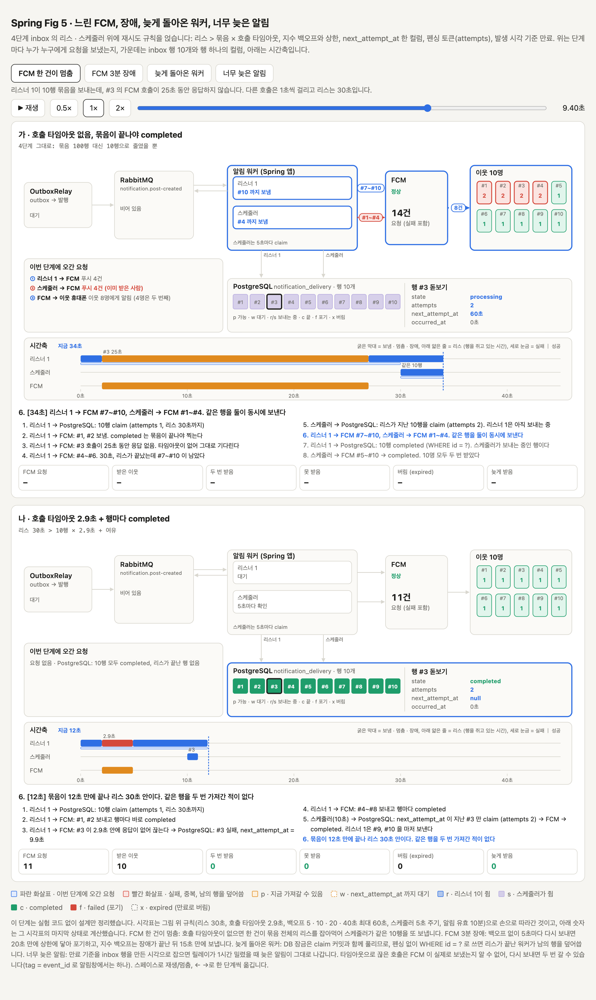

# 06. 설계 ④: 재시도와 리스 (느린 외부 API, 장애, 늦게 돌아온 워커, 너무 늦은 알림)

장애 상황 훈련: [05. inbox 와 리스](05-rabbitmq-inbox.md)로 "이웃마다 알림 하나"는 지켰습니다. 이번에는 푸시를 보내는 외부 서비스(FCM)가 **느려지거나 멈출 때** 그 설계가 어떻게 무너지는지 따라가고, 재시도 규칙을 정합니다.

이 단계는 **실험 코드 없이 설계만** 정리합니다. 구현은 서킷 브레이커를 다루는 Resilience4j 단계에서 이 노트를 기준으로 합니다. 그림의 시각표는 아래 규칙으로 손으로 따라간 것입니다.

## 문제: 리스 30초가 "보내는 중"을 지켜 주지 못하는 순간

05 의 설계는 행을 `processing` + `claimed_at` 으로 표시하고 커넥션을 반납한 뒤 FCM 을 부릅니다. 리스(30초)가 지나면 스케줄러가 그 행을 "죽은 워커의 행"으로 보고 다시 가져갑니다. 그런데 아래 경우에는 **살아 있는 워커의 행**도 리스가 끝납니다.

- FCM 한 건이 응답하지 않고, 호출 타임아웃이 없어 계속 기다린다.
- FCM 전체가 느려져 100명 묶음 하나를 보내는 데 40초가 걸린다.
- 워커가 GC 나 CPU 부족으로 리스보다 오래 멈춘다.

그러면 같은 행을 두 워커가 동시에 쥐고 같은 이웃에게 또 보냅니다. FCM 이 계속 느리면 30초마다 사본이 하나씩 늘어, 이미 느린 FCM 에 요청이 몇 배로 몰립니다(재시도 폭주). 한편 FCM 이 아예 멈추면, 실패한 행을 언제 다시 보낼지와 언제 포기할지 정한 규칙이 없습니다.

## 설계를 정한 순서

| 질문 | 결정 | 남은 빈틈 |
|---|---|---|
| 보내는 중인 행이 왜 리스를 넘기나? | 리스는 **묶음 전체**를 지켜야 한다. FCM HTTP v1 은 요청 하나에 기기 하나라서, 묶음은 호출 N 번이다 | 호출 한 번이 끝없이 걸리면 묶음 시간에 상한이 없다 |
| 묶음 시간에 상한을 두려면? | **호출 타임아웃**(2.9초)을 걸고 `리스 > 묶음 크기 × 호출 타임아웃 + 여유`. 30초 > 10 × 2.9초 | 타임아웃이나 503 으로 실패한 행은? |
| 실패한 행은? | 다시 보낸다. 다만 **횟수 상한**(`attempts`)을 넘으면 `failed` 로 포기 | 5초마다 바로 다시 보내면 상한을 몇 초 만에 다 쓴다 |
| 언제 다시 보내나? | **지수 백오프**: 5 · 10 · 20 · 40초, 최대 60초. 다음 시도 시각을 행에 적는다 | 계산식을 WHERE 에 넣으면 인덱스를 못 탄다 |
| 시각을 어디에 적나? | `next_attempt_at` 한 컬럼. claim 이면 `+리스`, 실패면 `+백오프`, 성공이면 `null`. **리스와 재시도 대기가 같은 조건**이 된다 | 리스가 끝난 뒤 늦게 돌아온 워커가 남의 행을 덮어쓰면? |
| 늦게 돌아온 워커는? | **펜싱 토큰**: claim 때 `attempts + 1` 을 돌려받아 두고, 끝내기·실패 기록에 `WHERE attempts = 내 값` | 장애가 1시간 이어졌다 풀리면 1시간 전 "새 글"을 보내나? |
| 너무 늦은 알림은? | **만료**: 이벤트 발생 시각 + 10분이 지나면 보내지 않고 `expired` 로 기록. 기준은 inbox 행을 만든 시각이 아니라 **메시지에 실은 `occurredAt`** | |

## 행에 생기는 컬럼

| 05 (step04) | 06 | 뜻 |
|---|---|---|
| `state` | `state` | `pending` · `processing` · `completed` 에 `failed` · `expired` 추가 |
| `claimed_at` | `next_attempt_at` | 이 시각이 지나야 가져갈 수 있다. 리스 끝, 백오프 끝을 함께 나타낸다. 끝난 행은 `null` |
| | `attempts` | **가져간 횟수**(실패 횟수가 아님). 상한 판단과 펜싱 토큰을 겸한다 |
| `created_at` | `occurred_at` | 글이 쓰인 시각(outbox 행을 저장한 시각). 메시지에 실어 온다 |

`attempts` 를 실패할 때가 아니라 **가져갈 때** 올리는 이유: 보내다 죽은 경우도 한 번으로 셉니다. 어떤 행 때문에 워커가 매번 죽어도(독이 든 행) 상한에 닿으면 `failed` 로 빠집니다. 실패할 때만 세면 죽는 경우에는 숫자가 영원히 오르지 않습니다.

## 동작

| 순간 | `next_attempt_at` | `attempts` | `state` |
|---|---|---|---|
| INSERT | 지금 | 0 | `pending` |
| claim | 지금 + 리스 30초 | +1 | `processing` |
| 성공 | `null` | 그대로 | `completed` |
| 실패 | 지금 + 백오프 | 그대로 | `pending` |
| 상한 초과 | `null` | 그대로 | `failed` |
| 만료 | `null` | 그대로 | `expired` |
| 보내다 죽음 | 아무것도 안 함. 리스가 끝나면 저절로 다시 가져갈 수 있다 | | |

죽은 경우와 실패한 경우가 스케줄러 입장에서는 똑같이 "다음 시도 시각이 지난 행"입니다. 복구 경로가 하나뿐입니다.

```sql
-- claim: 한 문장, 짧은 트랜잭션. 행 잠금은 이 커밋과 함께 풀린다
update notification_delivery
set state = 'processing', next_attempt_at = :now + interval '30 seconds', attempts = attempts + 1
where id in (
    select id from notification_delivery
    where next_attempt_at <= :now and occurred_at > :now - interval '10 minutes'
    order by next_attempt_at limit 10
    for update skip locked
)
returning id, user_id, attempts            -- attempts 를 기억해 둔다 (펜싱 토큰)

-- 만료: 같은 주기에 따로
update notification_delivery set state = 'expired', next_attempt_at = null
where next_attempt_at <= :now and occurred_at <= :now - interval '10 minutes'

-- 성공 (한 행씩)
update notification_delivery set state = 'completed', next_attempt_at = null
where id = :id and attempts = :myAttempts  -- 0행이면 이미 남의 행. 아무것도 안 한다

-- 실패
update notification_delivery
set state = case when attempts >= 10 then 'failed' else 'pending' end,
    next_attempt_at = case when attempts >= 10 then null
                           else :now + least(interval '60 seconds', interval '5 seconds' * power(2, attempts - 1)) end
where id = :id and attempts = :myAttempts
```

인덱스는 `next_attempt_at` 에 겁니다(`where next_attempt_at is not null` 부분 인덱스). 장애로 밀린 행이 수십만 개여도 claim 이 "시각이 된 행"만 바로 찾습니다. `attempts` 와 마지막 시도 시각으로 `claimed_at + 5초 × 2^(attempts-1) <= now` 처럼 계산해도 맞지만, 계산식은 평범한 인덱스를 못 타서 끝나지 않은 행을 모두 훑습니다. 백오프 정책을 바꿀 때도 SQL 이 아니라 실패를 기록하는 코드만 고치면 됩니다.

[](https://kbj804.github.io/java-in-practice/study/spring/figures/step05-retry-lease-fencing/index-light.html)

움직이는 버전: [라이트](https://kbj804.github.io/java-in-practice/study/spring/figures/step05-retry-lease-fencing/index-light.html) · [다크](https://kbj804.github.io/java-in-practice/study/spring/figures/step05-retry-lease-fencing/index.html). 위는 부품과 단계마다 오간 요청, 가운데는 inbox 행 10개와 행 하나의 컬럼, 아래는 시간축(누가 언제 행을 쥐었고, 보냈고, 멈췄나)입니다. 위 버튼으로 네 장면을 바꿀 수 있습니다([FCM 3분 장애](figures/step05-retry-lease-fencing/figure-outage-light.png) · [늦게 돌아온 워커](figures/step05-retry-lease-fencing/figure-fence-light.png) · [너무 늦은 알림](figures/step05-retry-lease-fencing/figure-late-light.png)).

## 네 장면

묶음 10행, 리스 30초, 스케줄러 5초 주기, 알림 유효 10분.

| 장면 · 방법 | FCM 요청 | 받은 이웃 | 두 번 받음 | 못 받음 | 버림 | 늦게 받음 |
|---|---|---|---|---|---|---|
| FCM 한 건이 25초 멈춤 · 가 타임아웃 없음, 묶음 끝에 completed | 20 | 10 | **10** | 0 | 0 | 0 |
| FCM 한 건이 25초 멈춤 · 나 타임아웃 2.9초, 행마다 completed | 11 | 10 | 0 | 0 | 0 | 0 |
| FCM 3분 장애 · 가 상한 5번, 백오프 없음 | 50 | 0 | 0 | **10** | 0 | 0 |
| FCM 3분 장애 · 나 지수 백오프 (최대 60초) | 70 | 10 | 0 | 0 | 0 | 0 |
| 워커가 GC 로 35초 멈춤 · 가 `WHERE id = ?` | 30 | 10 | **10** | 0 | 0 | 0 |
| 워커가 GC 로 35초 멈춤 · 나 `WHERE id = ? AND attempts = 내 값` | 20 | 10 | 0 | 0 | 0 | 0 |
| 릴레이가 1시간 밀림 · 가 만료 기준 = inbox 행 `created_at` | 10 | 10 | 0 | 0 | 0 | **10** |
| 릴레이가 1시간 밀림 · 나 만료 기준 = 메시지의 `occurredAt` | 0 | 0 | 0 | 0 | 10 | 0 |

### 한 건이 멈추면 왜 10명이 모두 두 번 받나

1. #3 호출이 25초 걸리는 동안 묶음이 멈춥니다. 30초에 리스가 끝났을 때 #7~#10 이 남았습니다.
2. 스케줄러가 리스 지난 10행을 모두 가져갑니다. #1~#6 은 이미 보냈지만 `completed` 는 묶음이 끝나야 찍혀서 아직 `processing` 입니다.
3. 리스너 1 은 #7~#10 을, 스케줄러는 #1~#10 을 다시 보냅니다. 리스너 1 의 `completed` 는 스케줄러가 보내는 중인 행을 덮어씁니다.

타임아웃 2.9초면 #3 은 실패로 기록되고 묶음은 12초에 끝납니다. #3 은 백오프 뒤에 스케줄러가 다시 보냅니다. 행마다 `completed` 를 찍으면 죽었을 때 다시 보낼 행도 "보내던 한 건"으로 줄어듭니다. 대신 커밋이 묶음당 1번에서 사람당 1번으로 늘어납니다.

### 백오프는 요청이 더 많은데 왜 낫나

가는 20초 안에 50건을 몰아 보내고 포기합니다. 장애가 3분이면 그 뒤에 살아나도 보낼 행이 없습니다. 상한 없이 5초마다 다시 보내면 3분 동안 370건이 됩니다. 나는 3분에 걸쳐 70건을 점점 드물게 보내고, 장애가 끝난 뒤 15초 만에 보냅니다. 백오프의 목적은 요청 수를 줄이는 것보다 **장애 중인 상대를 몰아붙이지 않으면서 회복을 기다리는 것**입니다.

### DB 잠금이 있는데 왜 두 워커가 같은 행을 쥐나

`FOR UPDATE SKIP LOCKED` 의 행 잠금은 claim 트랜잭션 동안(몇 ms)만 걸립니다. FCM 을 부르는 동안 커넥션을 쥐지 않으려고 일부러 커밋한 것이라, 보내는 동안 행을 지키는 것은 리스뿐입니다. 리스너 1 이 35초 멈추면 31초에 스케줄러가 잠기지 않은 그 행을 정상적으로 가져갑니다. 펜싱 토큰은 늦게 돌아온 쪽의 **기록**을 막습니다. 이미 나간 푸시는 막지 못하고, 알림창에서는 `tag = event_id` 로 하나만 보입니다.

### 만료 기준이 왜 발생 시각이어야 하나

inbox 행은 워커가 메시지를 받은 10:00 에 만들어집니다. 릴레이가 1시간 밀렸으면 `created_at + 10분` 은 아직 미래라서 1시간 지난 글이 "새 글"로 갑니다. 글이 쓰인 시각은 outbox 행을 저장한 시각과 같습니다(같은 트랜잭션). 이 값을 메시지에 `occurredAt` 으로 실어 보내면, 워커가 게시글 표를 다시 읽지 않고도 판단합니다. CloudEvents 표준의 `time` 필드와 같은 역할입니다.

## 헷갈리기 쉬운 것

- **"100명 묶음 = 요청 한 번"이 아닙니다.** FCM HTTP v1 은 요청 하나에 메시지 하나입니다. Admin SDK 의 `sendEachForMulticast` 도 안에서 기기마다 요청을 보냅니다. 예전 일괄 전송 API 는 종료됐습니다.
- **호출 타임아웃은 요청 한 건에 걸립니다.** 타임아웃 40초면 10건 묶음의 최악은 400초입니다.
- **FCM 이 느려도 DB 커넥션 풀이 먼저 고갈되지는 않습니다.** claim 커밋 뒤 커넥션을 반납했기 때문입니다. 막히는 건 리스너 스레드입니다. 트랜잭션 안에서 외부 API 를 불렀다면 풀이 먼저 고갈됩니다([02](02-connection-pool.md)).
- **스케줄러 주기는 폭주의 원인이 아닙니다.** `@Scheduled(fixedDelay)` 는 앞 실행이 끝나야 다음을 시작합니다. 폭주는 `처리 시간 > 리스` 에서 옵니다.
- **타임아웃은 "안 갔다"가 아니라 "모른다"입니다.** 끊은 요청을 FCM 이 실제로 보냈을 수 있어서, 다시 보내면 두 번 갈 수 있습니다.

## 남은 숙제 (Resilience4j 단계에서)

- **서킷 브레이커.** 실패가 몰리면 행마다 백오프를 기다리기 전에 FCM 호출 자체를 잠시 멈춥니다. 열려 있는 동안은 claim 도 쉬어야 `attempts` 를 헛되이 쓰지 않습니다([03](03-concurrency-limits.md)).
- **지터.** 장애 중 쌓인 행이 모두 같은 백오프 시각에 깨어나면 회복 직후 다시 몰립니다. 백오프에 무작위 지연을 섞습니다.
- **리스 연장(하트비트).** 묶음을 크게 잡아야 한다면, 보내는 도중에 `next_attempt_at` 을 `WHERE attempts = 내 값` 조건으로 밀어 리스를 늘립니다.
- **`failed` · `expired` 알림.** 하루에 버린 건수, 가장 오래된 `pending` 의 나이를 지표로 둡니다. 늘면 FCM 이나 릴레이 장애입니다.
- **청소.** 끝난 행(`completed` · `failed` · `expired`)을 며칠 뒤 지우거나 파티션으로 떼어 냅니다.

## Python에서는?

- Celery 의 `autoretry_for` + `retry_backoff=True` + `retry_backoff_max` + `retry_jitter` 가 지수 백오프와 지터, `max_retries` 가 상한입니다. 여기서는 재시도 상태를 브로커가 아니라 DB 행(`attempts`, `next_attempt_at`)에 둡니다.
- Celery 작업의 `expires` 가 만료입니다. 이 시각이 지난 작업은 워커가 받아도 실행하지 않습니다.
- httpx 의 `timeout=` 처럼 호출마다 타임아웃을 거는 것은 Java HTTP 클라이언트(`HttpClient` · `RestClient`)도 같습니다. 기본값이 "무한"인 클라이언트가 많아 직접 정해야 합니다.

## 정리: 설계할 때 지킬 것

1. **리스는 묶음 전체의 최악 시간보다 길게.** `리스 > 묶음 크기 × 호출 타임아웃 + 여유`. 호출 타임아웃이 없으면 이 부등식이 성립하지 않습니다.
2. **외부 호출에는 반드시 타임아웃.** 끝나지 않는 호출은 실패로도 집계되지 않습니다.
3. **재시도에는 상한과 간격.** 상한만 있으면 장애 초반에 다 쓰고, 간격만 있으면 끝없이 돕니다.
4. **다음 시도 시각을 행에 적는다.** `next_attempt_at` 하나로 리스 · 백오프 · 완료를 표현하고 인덱스를 겁니다.
5. **늦게 돌아온 쪽은 기록하지 못하게.** 가져갈 때마다 오르는 값(`attempts`)을 펜싱 토큰으로 씁니다.
6. **가치가 사라지는 데이터는 버린다.** 알림은 늦으면 의미가 없습니다. 기준은 처리 시각이 아니라 일이 일어난 시각입니다. 버린 사실은 `expired` 로 남깁니다.

## 출처

- [Firebase 문서: Send messages (HTTP v1 API)](https://firebase.google.com/docs/cloud-messaging/send-message)
- [Martin Kleppmann: How to do distributed locking (펜싱 토큰)](https://martin.kleppmann.com/2016/02/08/how-to-do-distributed-locking.html)
- [AWS Architecture Blog: Exponential Backoff And Jitter](https://aws.amazon.com/blogs/architecture/exponential-backoff-and-jitter/)
- [PostgreSQL 문서: SELECT … FOR UPDATE SKIP LOCKED (Locking Clause)](https://www.postgresql.org/docs/17/sql-select.html#SQL-FOR-UPDATE-SHARE)
- [db-scheduler (DB 행으로 다음 실행 시각과 하트비트를 관리하는 Java 스케줄러)](https://github.com/kagkarlsson/db-scheduler)
- [Celery 문서: Automatic retry for known exceptions](https://docs.celeryq.dev/en/stable/userguide/tasks.html#automatic-retry-for-known-exceptions)
- [CloudEvents 명세: time 속성](https://github.com/cloudevents/spec/blob/main/cloudevents/spec.md#time)
