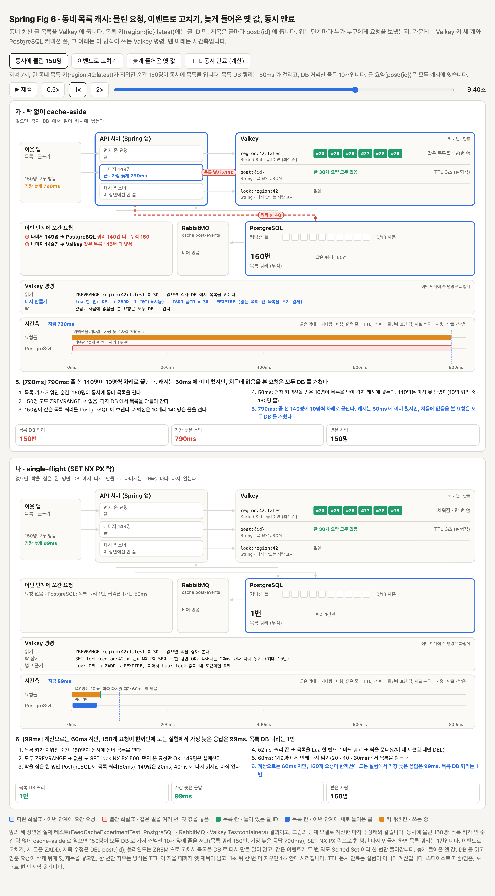

# 07. 실험 ⑤: Valkey 캐시로 동네 목록 읽기 (몰린 요청, 이벤트로 고치기, 늦게 들어온 옛 값, 동시 만료)

장애 상황 훈련: 동네 게시판 첫 화면은 "우리 동네 최신 글 20개"입니다. 저녁 시간에 한 동네에서만 초당 수천 번 열리는데, 매번 PostgreSQL 에서 `WHERE region_id = ? ORDER BY id DESC LIMIT 20` 을 돌리면 DB 가 버팁니다. 그래서 이 목록을 Valkey(Redis 와 같은 프로토콜의 인메모리 저장소)에 둡니다.

캐시를 "저장하고 꺼내 쓰기"로만 보면 쉬워 보입니다. 실제로 어려운 곳은 **언제 어떻게 고치느냐**와 **비어 있는 순간**입니다. 코드는 [lab/step06-valkey-cache](lab/step06-valkey-cache), 실험은 `FeedCacheExperimentTest` 입니다.

## 설계를 정한 순서

| 질문 | 결정 | 남은 빈틈 |
|---|---|---|
| 무엇을 어떤 키로? | 키는 "무엇의 캐시인가"를 가리키는 이름(`region:{id}:latest`), 값은 글 ID. 글 ID 와 키는 다른 것이다 | 목록에 제목도 넣으면 제목을 고칠 때는? |
| 목록에 제목도 넣으면? | 원소가 통째로 문자열이라 "읽기 → 자리 찾기 → 그 자리에 쓰기"가 된다. 그 사이에 새 글이 들어오면 자리 번호가 밀려 **남의 글을 덮어쓴다**. 그래서 **목록에는 ID 만**, 제목은 글마다 `post:{id}` | 누가 언제 캐시를 고치나? |
| 누가 고치나? | 글 API 는 Valkey 를 모른다. outbox → RabbitMQ 로 온 이벤트를 **캐시 리스너**가 받아 고친다 | 고칠 때 새 값을 쓰나, 지우나? |
| 고칠 때는? | 새 값을 쓰지 않고 **지운다**(`DEL post:{id}`). 이벤트 순서가 뒤바뀌거나 두 번 와도 결과가 같다. 다음 조회가 DB 에서 새 값을 읽어 채운다(cache-aside) | 목록에서 글이 빠지면 빈자리는? |
| 목록에서 빼면? | 값으로 뺀다(`ZREM`). 빈자리를 채우려고 DB 에 가지 않도록 **100개를 남겨 두고 20개만 보여 준다** | 목록 키를 통째로 지우면? |
| 목록 키가 비면? | 그 순간 몰린 요청이 모두 DB 로 간다(**캐시 스탬피드**). 사람이 몰리는 키는 지우지 않고, 비었을 때는 **한 명만** 다시 만든다(single-flight, `SET NX PX` 락) | 락을 쥔 서버가 죽으면? |
| 락을 쥔 쪽이 죽으면? | `PX` 가 락을 저절로 지운다. step05 의 리스와 같다. `PX > 다시 만드는 최악 시간` | DB 를 읽고 멈춘 요청이 지운 뒤에 옛 값을 넣으면? |
| 늦게 들어온 옛 값은? | **TTL** 로 남는 시간의 상한을 두고, **지연 이중 삭제**(1초 뒤 한 번 더 지움)로 대부분을 줄인다 | 같은 때 채운 키가 같은 때 만료되면? |
| 동시 만료는? | TTL 에 **지터**(0~2분 무작위)를 더한다. 읽을 때 TTL 을 늘리면 옛 값이 영원히 남으니 늘리지 않는다 | |

## 키 구조

```
region:42:latest   Sorted Set   [글 ID 100개, 점수 = 글 ID]  + 표시용 "0"(점수 -1)   TTL 10분 + 0~2분
post:7008          String       {"id":7008,"regionId":42,"authorId":…,"title":"…","createdAt":…}   TTL 10분 + 0~2분
lock:region:42     String       <토큰>                                                  PX 500ms
```

읽기는 `ZREVRANGE region:42:latest 0 30` 으로 ID 를 받고 `MGET post:…` 로 요약을 한 번에 받습니다. 요약이 없는 글만 DB 에서 읽어 `SET … EX` 로 채웁니다.

### List 가 아니라 Sorted Set 인 이유

문답에서는 List(`LPUSH` · `LREM`)로 이야기했지만 구현은 Sorted Set 으로 했습니다. 이벤트로 고치는 캐시에는 이쪽이 맞습니다.

| | List | Sorted Set (점수 = 글 ID) |
|---|---|---|
| 같은 새 글 이벤트가 두 번 옴(step04 의 중복 메시지) | `LPUSH` 두 번 → 같은 글이 두 줄 | `ZADD` 두 번 → 한 줄 (같은 값은 하나) |
| 이벤트가 늦게 옴(글 5 다음 글 4) | 늦게 온 글 4 가 맨 앞 | 점수로 정렬되어 글 5 가 맨 앞 |
| 글 하나 빼기 | `LREM` 은 값으로 빼서 안전 | `ZREM` 도 값으로 뺀다 |
| 100개만 남기기 | `LTRIM 0 99` | `ZREMRANGEBYRANK` |

점수는 double 이라 2^53 보다 큰 정수는 뭉개집니다. 글 ID 를 64비트 Snowflake 로 만들면 점수를 ID 대신 생성 시각(ms)으로 두면 됩니다. Snowflake ID 는 앞부분이 시각이라 ID 순서와 시각 순서가 같습니다.

### 표시용 원소 "0" 과 "키가 있을 때만 넣기"

- **키가 있으면 "완전한 목록"이어야 합니다.** 목록 키가 만료된 뒤 새 글 이벤트가 와서 `ZADD` 하면 글 하나짜리 목록이 생기고, 읽는 쪽은 그것을 동네 목록 전체로 믿습니다. 그래서 새 글 이벤트는 Lua 로 `EXISTS` 를 확인하고 **키가 있을 때만** 넣습니다.
- **글이 없는 동네도 키를 만듭니다.** 다시 만들 때 표시용 원소 `"0"` 을 함께 넣어서, 빈 동네도 "키 있음"이 됩니다. 넣지 않으면 글이 없는 동네는 열 때마다 DB 로 갑니다(빈 결과도 캐시하는 negative caching).
- **다시 만들기는 Lua 한 번**(`DEL → ZADD -1 "0" → ZADD 글ID … → PEXPIRE`)이라 읽는 쪽이 빈 목록을 보는 순간이 없습니다.

## 이벤트로 고치기

| 이벤트 | 캐시 리스너가 하는 일 |
|---|---|
| `PostCreated` | `region:{id}:latest` 가 있으면 `ZADD 글ID 글ID`, 100개를 넘으면 오래된 것부터 자름 |
| `PostUpdated` (제목 수정) | `DEL post:{id}`, 1초 뒤 한 번 더 `DEL`. 목록의 ID 는 그대로 |
| `PostBlinded` (신고로 가림) | `ZREM region:{id}:latest 글ID` + `DEL post:{id}` (+ 1초 뒤 한 번 더) |

알림 워커(step04)와 캐시 리스너는 같은 exchange 에 큐를 하나씩 묶어 같은 이벤트를 각자 한 부씩 받습니다. 셋 다 두 번 실행해도 결과가 같아서, step04 처럼 inbox 표를 두지 않아도 됩니다.

## 비어 있는 순간: 캐시 스탬피드와 single-flight

목록 키가 빈 50ms 동안 들어온 요청은 모두 "없음"을 보고 DB 로 갑니다. 초당 3,000명이면 약 150명입니다. 커넥션 풀이 10개면 140명은 줄을 서고, 모두 **같은 목록**을 150번 만듭니다.

single-flight 는 "누가 다시 만들지"를 Valkey 가 하나만 정하게 합니다. step04 의 `ON CONFLICT DO NOTHING` · `SKIP LOCKED` 처럼 원자적으로 한 명만 성공하는 명령을 씁니다.

```
① ZREVRANGE region:42:latest 0 30
   ├ 있음 → 응답                                 ← 거의 모든 요청은 여기서 끝
   └ 없음 → ② SET lock:region:42 <토큰> NX PX 500
              ├ OK   → 한 번 더 읽기(방금 누가 채웠을 수도) → DB 조회 → 목록 넣기 → 내 토큰이면 DEL lock
              └ 실패 → 20ms 쉬고 ① 로 (10번까지). 다 기다려도 없으면 DB 에서 직접 만든다
```

- **`PX` 는 락의 리스입니다.** 락을 잡은 서버가 GC 로 멈추거나 죽어도 500ms 뒤에는 다른 요청이 잡습니다. `PX` 가 없으면 락이 영원히 남아, 목록이 빌 때마다 모두 최대 대기(200ms)를 기다린 뒤 각자 DB 로 갑니다. single-flight 가 사라지고 스탬피드가 돌아옵니다.
- **`PX` 와 기다리는 쪽의 최대 대기는 모두 "다시 만드는 최악 시간"보다 길어야 합니다**(step05 의 `리스 > 묶음 × 호출 타임아웃`). `PX` 가 짧으면 조회 도중에 락이 풀려 두 번째 사람이 또 DB 에 가고, 최대 대기가 짧으면 기다리던 사람들이 포기하고 모두 DB 로 갑니다. 실험 준비 중 쿼리가 실수로 1.5초 걸렸을 때, 기다리던 149명이 최대 대기(200ms)를 넘겨 각자 DB 로 가서 single-flight 인데도 DB 에 150번 갔습니다.
- **너무 길면** 락을 쥔 서버가 죽었을 때 그동안 빈 목록을 본 요청이 모두 최대 대기를 채운 뒤 각자 DB 로 갑니다. 기다리는 상한이 없다면 API 타임아웃에 걸립니다. 최대 대기(20ms × 10 = 200ms)는 다시 만드는 시간(50ms)보다 길고 API 타임아웃보다 짧게 둡니다.
- **풀 때는 토큰을 확인합니다.** 그냥 `DEL` 하면, 멈췄다 깨어난 내가 `PX` 가 지나 남이 새로 잡은 락을 지웁니다. step05 의 펜싱과 같은 문제라, "값이 내 토큰이면 지우기"를 Lua 로 한 번에 실행합니다.
- 이 락은 **효율용**입니다. 가끔 두 명이 잡아도 DB 조회가 한 번 더 될 뿐이라 펜싱까지는 두지 않습니다. 운영에서는 Redisson 의 `RLock` 처럼 검증된 구현을 쓰는 편이 낫고, 여기서는 NX · PX 가 하는 일을 보이려고 직접 썼습니다.

**레이트 리밋(429)으로 막으면 안 되나?** 이 상황의 150명은 모두 같은 값을 원합니다. 429 를 주면 잘못한 게 없는 사용자에게 오류를 주거나, 클라이언트가 다시 요청하게 해서 기다리는 시간을 서버 안 50ms 에서 휴대폰 왕복으로 옮기게 됩니다. 레이트 리밋과 동시 실행 상한(벌크헤드)은 **Valkey 가 통째로 죽어서 모든 요청이 DB 로 갈 때** DB 를 지키는 데 씁니다(Resilience4j 단계).

## 늦게 들어온 옛 값과 지연 이중 삭제

cache-aside 에는 지워도 옛 값이 다시 들어오는 틈이 있습니다.

```
요청 R:     GET post:7 없음 → DB 에서 v1 읽기 ── (GC 로 멈춤) ──────────────── SET post:7 v1
작성자:                         UPDATE v2 → 커밋
캐시 리스너:                                       DEL post:7 (지울 것 없음, 끝)
```

리스너는 이미 할 일을 끝냈고 더 올 이벤트가 없습니다. TTL 이 없으면 `post:7` 에는 **v1 이 영원히** 남습니다. 창은 몇 ms 지만 초당 수천 건이면 언젠가 일어납니다.

**지연 이중 삭제**는 지우고 나서 **조금 뒤(여기서는 1초) 한 번 더 지우는 것**입니다.

```
캐시 리스너:  DEL post:7 ─────── 1초 ─────── DEL post:7 (두 번째)
요청 R:                 SET post:7 v1 ─────────────┘ 여기서 지워짐
```

R 처럼 "DB 를 읽은 뒤 캐시에 넣기까지" 걸린 시간이 1초보다 짧으면, 그 옛 값은 두 번째 삭제가 지웁니다. 더 늦은 SET 은 TTL 이 지웁니다. 두 번째 삭제는 서버 메모리에 걸어 둔 예약(`TaskScheduler`)이라 그 사이에 서버가 죽으면 사라집니다. 그래도 TTL 이 남아 있으니 최대 TTL 만큼만 틀립니다. 꼭 지켜야 하면 RabbitMQ 지연 큐로 두 번째 삭제를 메시지로 남깁니다.

이 경쟁을 정면으로 막는 방법도 있습니다. Facebook memcache 는 miss 때 캐시가 **lease 토큰**을 주고, 그 사이 삭제가 오면 토큰을 무효로 만들어 늦은 SET 을 거절합니다. Valkey 에는 기본 기능이 아니라 Lua 로 흉내 내야 합니다.

## TTL 과 지터

- 평소 수정은 이벤트가 즉시 고치고, **TTL 은 틀린 값이 남는 최대 시간**을 정합니다. 둘이 짝입니다. 제목 오타가 10분 남는 건 괜찮지만, 블라인드 글이 10분 보이는 건 곤란할 수 있습니다. 그래서 이벤트로 지울 때는(제목 수정 · 블라인드 모두) 1초 뒤 한 번 더 지웁니다.
- **읽을 때 TTL 을 늘리면(sliding expiration) 안 됩니다.** 인기 글은 계속 읽혀서 만료되지 않고, 옛 값이 남았다면 가장 많은 사람이 가장 오래 봅니다.
- **같은 때 채운 키는 같은 때 만료됩니다.** 배포 직후 3초 동안 5만 개를 `EX 600` 으로 채우면 7시 10분에 3초 동안 5만 개가 사라져 DB 에 초당 약 1만 7천 건이 몰립니다. 키가 다 달라서 single-flight 로도 못 막습니다. `EX 600 + 무작위 0~120` 이면 2분에 흩어져 초당 약 420건입니다. 노트 06 의 백오프 지터와 같은 생각입니다.

## 실험 결과

목록 DB 쿼리는 50ms 가 걸리게 해 두고(`cache.feed.rebuild-delay`, `pg_sleep`), 커넥션 풀은 10개, 실험에서는 글 요약 TTL 을 3초로 줄였습니다. 네 번 돌린 범위입니다.

| 장면 · 방법 | 결과 |
|---|---|
| 목록 키가 빈 순간 동시 150명 · 가 락 없이 cache-aside | 목록 DB 쿼리 **150번**, 가장 늦은 응답 788~831ms |
| 목록 키가 빈 순간 동시 150명 · 나 single-flight | 목록 DB 쿼리 **1번**, 가장 늦은 응답 89~117ms |
| 새 글 · 제목 수정 · 블라인드 · 같은 새 글 2번 · 다 이벤트로 고치기 | 목록 `[글 4, 글 2 (오타 고침), 글 1]`, 목록 다시 만들기 **0번** |
| DB 를 읽고 멈춘 요청이 삭제 뒤 옛 제목을 넣음 · 라 한 번만 지움 | 옛 제목이 보인 시간 3,038~3,045ms (TTL 3초가 지움) |
| 같은 상황 · 마 지연 이중 삭제 1초 | 옛 제목이 보인 시간 950~956ms |

```bash
./gradlew :step06-valkey-cache:test --tests '*FeedCache*' -i | grep 실험
```

[](https://kbj804.github.io/java-in-practice/study/spring/figures/step06-valkey-cache/index-light.html)

움직이는 버전: [라이트](https://kbj804.github.io/java-in-practice/study/spring/figures/step06-valkey-cache/index-light.html) · [다크](https://kbj804.github.io/java-in-practice/study/spring/figures/step06-valkey-cache/index.html). 위는 이웃 앱 · API 서버(요청과 캐시 리스너) · Valkey · PostgreSQL · RabbitMQ 사이에 단계마다 오간 요청, 가운데는 Valkey 키 세 개와 커넥션 풀, 그 아래는 그 방식이 쓰는 Valkey 명령(이번 단계에 쓴 줄을 칠함), 맨 아래는 시간축입니다. 위 버튼으로 네 장면을 바꿀 수 있습니다([이벤트로 고치기](figures/step06-valkey-cache/figure-event-light.png) · [늦게 들어온 옛 값](figures/step06-valkey-cache/figure-race-light.png) · [TTL 동시 만료(계산)](figures/step06-valkey-cache/figure-ttl-light.png)).

## 헷갈리기 쉬운 것

- **키와 ID 는 다릅니다.** Snowflake 는 글 ID 를 만드는 방법이고, 키는 `region:42:latest` 처럼 "무엇의 캐시인가"를 가리키는 이름입니다.
- **`PX` 는 기다리는 쪽의 타임아웃이 아닙니다.** 락 키 자체가 사라지는 시간입니다. 기다리는 쪽의 최대 대기는 따로 정합니다.
- **`SET NX` 가 실패한 요청도 캐시를 다시 읽습니다.** 실패는 "다른 사람이 만드는 중"이라는 뜻이라, 잠깐 뒤 캐시를 다시 보면 대개 채워져 있습니다.
- **지우는 쪽이 덮어쓰는 쪽보다 안전합니다.** `SET` 은 늦게 온 이벤트가 마지막에 남고, `DEL` 은 몇 번 어떤 순서로 와도 "없음"입니다.
- **이벤트로 넣는 것도 반쪽 목록을 만들 수 있습니다.** 목록 키가 없을 때는 넣지 않고, 다음 조회가 DB 에서 통째로 만들게 둡니다.
- **목록이 이벤트로 고쳐져도 다시 만들기와 겹치는 틈은 남습니다.** 다시 만드는 요청이 DB 를 읽은 직후 새 글 이벤트가 오면, 그 이벤트는 "키 없음"이라 넘어가고 다시 만든 목록에는 새 글이 빠집니다. 이것도 목록 TTL 이 상한입니다.

## Valkey 명령 참고

| 명령 | 하는 일 | 여기서 쓴 곳 |
|---|---|---|
| `GET key` / `SET key value` | 문자열 읽기 / 쓰기 | `post:{id}` |
| `SET key value EX 초` · `PX 밀리초` | 쓰면서 만료 시간도 건다(EX 는 초, PX 는 밀리초) | 글 요약 TTL, 락의 리스 |
| `SET key value NX` | 키가 **없을 때만** 쓴다(Not eXists). 동시에 여럿이 보내도 한 명만 OK | single-flight 락 |
| `MGET k1 k2 …` | 여러 키를 왕복 한 번에 읽는다. 없는 키는 null | 목록 20개의 요약 |
| `DEL key` | 지운다. 없어도 오류가 아니다 | 제목 수정 · 블라인드 · 락 풀기 |
| `EXISTS key` | 있으면 1 | 새 글을 넣기 전 확인 |
| `PEXPIRE key 밀리초` | 이미 있는 키에 만료를 건다 | 목록을 다시 만든 뒤 |
| `ZADD key 점수 값` | Sorted Set 에 넣는다. 같은 값은 점수만 바뀐다 | 새 글 |
| `ZREVRANGE key 0 n` | 점수가 큰 것부터 n+1 개. 6.2 부터는 같은 일을 하는 `ZRANGE key 0 n REV` 를 권한다 | 최신 글 ID 읽기 |
| `ZREM key 값` | 값으로 뺀다 | 블라인드 |
| `ZREMRANGEBYRANK key 시작 끝` | 순위(작은 점수부터 0) 범위를 지운다 | 100개만 남기기 |
| `LPUSH` · `LRANGE` · `LSET` · `LREM` · `LTRIM` | List 의 앞에 넣기 · 범위 읽기 · **자리 번호로** 덮어쓰기 · **값으로** 지우기 · 범위만 남기기 | (문답에서 비교한 방식) |
| `EVAL 스크립트` (Lua) | 여러 명령을 **한 번에**, 중간에 다른 명령이 끼어들지 못하게 실행 | 키가 있을 때만 넣기, 목록 바꿔 넣기, 내 토큰일 때만 락 풀기 |

Valkey 는 명령을 하나씩 차례로 처리합니다. 그래서 명령 **하나**와 Lua 스크립트 **하나**는 원자적입니다. "읽고 → 앱에서 판단하고 → 쓰기"처럼 명령 여러 개로 나누면 그 사이에 다른 요청이 끼어듭니다.

## 남은 숙제

- **Valkey 장애.** 지금 코드는 Valkey 명령이 실패하면 그대로 오류(500)를 냅니다. `spring.data.redis.timeout: 200ms` 로 오래 기다리지만 않게 해 두었습니다. Valkey 가 죽으면 원본 DB 로 읽어야(폴백) 하는데, 그때는 같은 키 하나가 아니라 **모든 요청**이 DB 로 가므로 DB 앞에 동시 실행 상한과 서킷 브레이커를 함께 둡니다(Resilience4j 단계, [03](03-concurrency-limits.md)).
- **로컬 캐시(Caffeine) 한 겹.** 서버 메모리 캐시를 앞에 두면 Valkey 왕복도 줄고, 같은 키를 동시에 요청하면 로더를 한 번만 돌려 서버 안 single-flight 가 됩니다. 대신 서버마다 따로 지워야 해서 수정 이벤트를 모든 서버가 받아야 합니다.
- **아주 뜨거운 키.** 한 동네 목록에 초당 수만 건이면 Valkey 노드 하나가 버거워집니다. 로컬 캐시나 복제본 읽기로 나눕니다.
- **만료 직전 미리 다시 만들기.** 인기 키는 만료되기 조금 전에 확률적으로 한 명이 미리 다시 만들게 하면 빈 순간 자체가 줄어듭니다.

## Python에서는?

- Django 의 `cache.get` / `cache.set(timeout=…)` / `cache.delete` 가 그대로 cache-aside 입니다. 시그널(`post_save`)에서 `cache.delete` 를 부르는 것이 "수정되면 지우기"입니다.
- dogpile.cache 는 이 노트의 single-flight 를 라이브러리로 해 줍니다. 값을 다시 만드는 동안 다른 요청은 기다리거나 옛 값을 받습니다(이름부터 스탬피드의 다른 이름인 dog-pile 입니다).
- redis-py 의 `r.set(key, token, nx=True, px=500)` 이 `SET NX PX` 이고, `r.register_script(lua)` 가 Lua 실행입니다.

## 정리: 캐시를 설계할 때 지킬 것

1. **순서(ID)와 내용(요약)을 나눈다.** 한 값 안에 섞으면 고칠 때 "읽고 고쳐 쓰기"가 되어 끼어들기에 깨집니다.
2. **고칠 때는 지운다.** 지우기는 순서가 뒤바뀌어도, 두 번 와도 결과가 같습니다.
3. **사람이 몰리는 키는 비우지 않는다.** 값으로 빼고(`ZREM`), 여유분을 두고, 다시 만들 때는 한 번에 바꿔 넣습니다.
4. **비었을 때는 한 명만 다시 만든다.** `SET NX PX` 의 `PX` 는 리스, 풀 때는 토큰 확인.
5. **TTL 은 안전망이다.** 이벤트가 놓친 경쟁의 상한입니다. 읽을 때 늘리지 말고, 지터를 붙입니다.
6. **캐시는 이벤트로 고친다.** 글 API 는 캐시를 모르고, outbox 가 이벤트를 놓치지 않게 합니다.

## 출처

- [Valkey 문서: SET (EX · PX · NX)](https://valkey.io/commands/set/)
- [Valkey 문서: ZADD](https://valkey.io/commands/zadd/) · [ZREMRANGEBYRANK](https://valkey.io/commands/zremrangebyrank/) · [LREM](https://valkey.io/commands/lrem/) · [EVAL](https://valkey.io/commands/eval/)
- [Redis 문서: Distributed locks with Redis](https://redis.io/docs/latest/develop/clients/patterns/distributed-locks/)
- [Martin Kleppmann: How to do distributed locking (효율용 락과 정확성용 락)](https://martin.kleppmann.com/2016/02/08/how-to-do-distributed-locking.html)
- [Nishtala 외, Scaling Memcache at Facebook (NSDI 2013, lease 로 늦은 SET 과 스탬피드 막기)](https://www.usenix.org/system/files/conference/nsdi13/nsdi13-final170_update.pdf)
- [AWS Builders' Library: Caching challenges and strategies](https://aws.amazon.com/builders-library/caching-challenges-and-strategies/)
- [Spring Data Redis 문서](https://docs.spring.io/spring-data/redis/reference/)
- [dogpile.cache 문서](https://dogpilecache.sqlalchemy.org/en/latest/)
